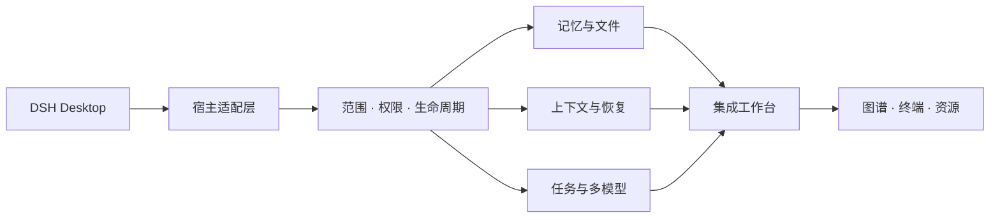

<div align="center">


# Noemaloom

**把记忆、上下文与协作，织成连续的工作空间。**

面向 DeepSeek Harness Desktop 的记忆、上下文与多模型编排工作台。

[](https://github.com/AlleinLin/dsh-noemaloom/actions/workflows/ci.yml)
[](https://github.com/deepseek-ai/deepseek-harness)
[](https://nodejs.org/)
[](docs/BUILDING.md)
[](LICENSE)

[快速开始](#快速开始) · [能力地图](#能力地图) · [工作原理](#工作原理) · [参与贡献](CONTRIBUTING.md) · [English](README.en.md)


</div>

## 为什么是 Noemaloom

当 Agent 的工作跨越文件、会话、模型与任务，工具越多，越需要一致的上下文。Noemaloom 将记忆、上下文压缩、任务编排、图谱和工作台入口组织到一个 DSH 插件中，让不同能力共享范围、权限与生命周期。

名字取自 **noema** 与 **loom**：前者指向思维中的内容，后者是一台织机。它希望把零散的信息，织成可以继续工作的线索。

> 当前为实验性集成项目。代码、单元测试和构建验证各有覆盖范围；第三方服务、真实模型、桌面交互和长时间运行需要在你的环境中另行验证。

## 能力地图


| 领域 | 代码覆盖的能力 |
| :--- | :--- |
| **记忆与文件** | 文件记忆、项目范围、检索、来源引用与记忆提供方适配 |
| **上下文** | 压缩、归档、可逆恢复与会话维护 |
| **任务与模型** | 工作流、子 Agent、模型目录、思考强度与任务洞察 |
| **图谱与工作台** | 关系图、原生界面适配、终端与工作空间入口 |
| **工程与资源** | 项目规则、工程方法、资源目录与扩展能力 |
| **恢复与连接** | 请求恢复、连接管理、取消与生命周期控制 |

能力是否可用取决于宿主版本、配置和相应服务。Python 记忆组件需要额外的 Python 环境及组件依赖；外部记忆服务需要各自配置。

## 快速开始

目标宿主为 **DeepSeek Harness Desktop 0.2.1-rc.2**。推荐使用 Node.js 24 LTS；Windows 桌面安装流程使用 PowerShell。

```powershell
npm ci --ignore-scripts
npm run check
npm run pack:delivery
```

`check` 依次构建、检查类型、运行测试并验证生成物。`pack:delivery` 审核实际 npm 安装包，并在 `build/` 写入安装包、安装清单、安装器与校验和。

保存工作，完全退出 DSH Desktop。先检查安装目标，再执行安装：

```powershell
.\build\install-desktop.ps1 -HarnessDirectory 'C:\Program Files\DeepSeek Harness' -CheckOnly
.\build\install-desktop.ps1 -HarnessDirectory 'C:\Program Files\DeepSeek Harness'
```

重新打开 Desktop，在插件管理中确认插件启用，再按需配置模型、记忆服务与工作空间。完整说明见 [构建与安装](docs/BUILDING.md)。

> **名称兼容性**：GitHub 仓库名为 `dsh-noemaloom`。当前运行时沿用 `@local/dsh-nexus` 与现有 `nexus-*` 注册标识，保留预设、适配器和已安装配置的兼容性。宿主部分入口仍会显示旧名称 Nexus。

## 工作原理




- **宿主适配**负责把 DSH 会话、工具和客户端入口接到统一的领域能力。
- **范围与权限**贯穿记忆、任务和扩展执行，配置入口存在不代表自动获得执行授权。
- **原生能力适配**保留上游实现，通过独立适配层处理宿主、平台和模块身份差异。
- **来源可追踪**：第三方源码、许可证、修改说明和来源记录随仓库保留。

架构细节见 [模块导览](docs/ARCHITECTURE.md)。

## 开发与验证

| 命令 | 用途 |
| :--- | :--- |
| `npm run build` | 构建宿主、客户端、原生能力及适配资源 |
| `npm run typecheck` | TypeScript 类型检查 |
| `npm test` | 运行测试，生成本次运行记录 |
| `npm run verify:artifacts` | 验证运行包入口与客户端隔离 |
| `npm run check` | 执行上述完整检查 |
| `npm run pack:delivery` | 生成并审核可安装交付物 |

测试记录写入本地 `evidence/`，构建输出写入 `lib/`、`build/`；这些文件不进入 Git。仓库保留验收定义与测试代码，历史机器的会话、截图和“已通过”报告不作为新版本的验证结果。

## 文档

| 入口 | 内容 |
| :--- | :--- |
| [构建与安装](docs/BUILDING.md) | 环境、安装、验证与卸载 |
| [模块导览](docs/ARCHITECTURE.md) | 领域模块、适配器与客户端 |
| [上下文恢复](docs/native-compaction-recovery.md) | 原生压缩与会话维护 |
| [辅助模型与旁路提示](docs/旁路提示与独立辅助模型.md) | 提示策略及辅助模型边界 |
| [来源索引](sources.lock.json) | 上游身份与源码来源 |
| [贡献指南](CONTRIBUTING.md) | 修改与验证要求 |

## 许可与致谢

原创集成代码采用 [MIT License](LICENSE-ORIGINAL)。第三方代码、模板、提示词与资源继续适用各组件许可证；整个分发包不统一宣称为 MIT。请阅读 [LICENSE](LICENSE)、[NOTICE](NOTICE) 和 [第三方声明](THIRD-PARTY-NOTICES.md)。

本项目使用 **[acp-kernel](https://github.com/ranxianglei/acp-kernel)** 与 **[billion-context](https://github.com/ranxianglei/billion-context)**；保留其产品出处标注条款。也感谢 DeepSeek Harness、DSH 社区和来源索引中记录的上游作者。

本项目是社区插件，与 DeepSeek 官方无隶属关系。

<sub>本页插画为 AI 生成的品牌概念图，不是实际界面截图或功能验收证据。生成记录见 [图片来源](docs/images/generation.json)。</sub>
