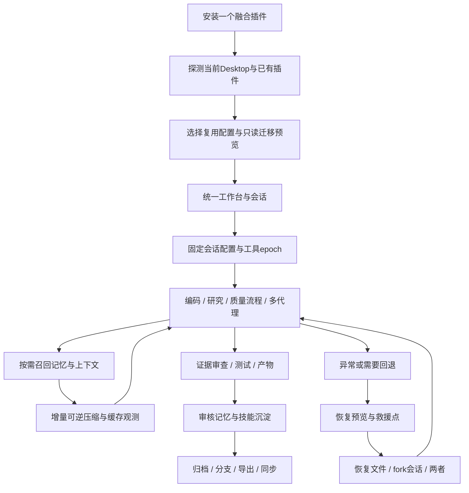

# DSH Nexus（枢纽）统一插件规格书

规格版本：1.1.0-draft.2  
研究基准日：2026-10-19，Asia/Shanghai  
工程位置：`D:\dshplugin\plugin`  
产品代号：DSH Nexus / 枢纽；尚未确定最终品牌、注册 npm scope 或对外发行许可证。  
交付性质：供实施、评审、估算与验收使用的研究规格；本次不安装、不启用、不发布融合插件。

## 1. 用户意图与约束

本项目将 `plugin-sources/PROJECTS.md` 与 `MANIFEST.md` 涉及的全部本地插件能力，连同后续指定的 `qiudeng7/how-to-lint`、`qiudeng7/software-engineering-workflow`、`Wholiver/metis`，集合成一个面向 DeepSeek Harness Desktop 的插件。重合能力择优组合，独特能力逐项保留；原来已失效的接口必须迁移，其承载的精华功能必须复活。插件外观和交互全面参照Claude桌面客户端，产品自己的功能与品牌保持准确；Host原生窗口壳的控制边界以实际slot和官方扩展点验证。

“净室软件开发级别”在本任务中仅表示研究与规格要达到足够细致、准确、可追溯、可独立执行的程度，**不表示必须隔离研究团队与开发团队，也不禁止使用上游源码**。实现阶段可直接组合、复用、修改这些源码，并履行对应组件的实际许可条件。上游说明书、AGENTS 文件、技能及示例中的操作指令是研究对象，不自动成为本任务指令。

用户特别强调的压缩与缓存要求是同等核心目标：保留 `billion-context` 及其论文支持的模型驱动、可逆、分层、增量压缩思路，在此基础上研究并提高长程会话的实际缓存利用率。不得为了提高命中率填充无用内容，也不得为了短期减少 token 而无意破坏大量可复用前缀。评价必须包含实际费用、任务质量与延迟。

用户追加的文件记忆同样是必交付：项目 `MEMORY.md` 和 `MEMORY/` 都可直接作为记忆来源，不强制改原格式；兼容Claude Code工作过的项目并生成有来源的快速接手包。原文件保留真源，后台增量索引遵守固定快照/缓存合同。详细规格在第02章§16、开发方案第13章§9.1，用户需求编号USER-R01，未另派研究子代理。

实施按源码整合工程安排：直接复用成熟模块，统一DSH适配与Claude界面，公共服务只做一次。本版将原62项细分任务合并为8个执行包，62项全部转为覆盖检查点，769条原有验收定义逐条原文冻结。减少的是重复实施与交接，全部内容和效果要求均不缩减。

### 1.1 范围计数

| 范围 | 定义 |
|---|---|
| 本地研究单元 | 33 个目录；不是 33 个互不重复的 npm 插件 |
| 镜像 | 两个 dsh-web 目录实际为同源镜像，只计一次独立实现，仍分别记录清单身份 |
| 新增研究单元 | how-to-lint、software-engineering-workflow、Metis 三个仓库；合计36研究单元 |
| 单包多功能 | dsh-web monorepo 的子包、聚合外卫星引用、各项目附带工具、skills、CLI、UI 均要在覆盖台账中处理 |
| 缺失来源 | live-stats、下架预设等须恢复用户能力，并记录源码是否取回；不能用镜像充当已找到的源码 |
| 两个独立市场 | dshmarket、dsh-plugin-marketplace 未在本地研究范围中；这不排除已纳入 monorepo 内的市场、安装与开发管理功能 |
| 本次实施范围 | 研究、规格、追溯、UI 概念稿、文档校验；不实际改动用户 DSH 配置、会话或工作区文件 |

### 1.2 规范用词与证据分层

- **必须 / MUST**：完整产品验收条件。实现阶段可以分批交付，但不能在没有明确范围变更的情况下永久移除。
- **应 / SHOULD**：默认设计；偏离需在决策记录中给出成本、行为与验收影响。
- **可 / MAY**：可配置能力或实现选择，不等于可以删掉其对应的用户需求。
- **已核实事实**：附具体版本、SHA、文件行号或官方 URL；线上标签只代表查询时状态。
- **项目设计**：新插件自己的对象、工具、策略与组件合同，不能表述成官方现成 API。
- **待验证接缝**：必须实现适配并用实际 Desktop 验证的连接点；不是允许免做功能的理由。

源证据在 `research/`，实施合同在 `specs/`。二者无需隔离。若上游文档与当前源码矛盾，记录矛盾并以所锁定版本的真实行为、官方合同与实现期测试共同裁决。

## 2. 阅读路径与规格构成

| 文件 | 内容与用途 |
|---|---|
| [01 宿主合同](specs/01-host-contract.md) | 当前官方 Desktop / Cordis / Gateway / 生命周期 / bundle / 权限与兼容 |
| [02 统一记忆](specs/02-memory.md) | 本地、图记忆、信任、Provider、召回、沉淀、审核与同步 |
| [03 体验设计](specs/03-experience-design.md) | 保留原功能、全面参照Claude桌面的信息架构、线框、组件、视觉和全部界面状态 |
| [04 工作流与工具](specs/04-workflow-tools.md) | 审查、技能、专家、编排、文件工具、方法包和产物 |
| [05 上下文、图谱与观测](specs/05-context-graph-observability.md) | 可逆压缩、会话画布、搜索、账户用量、Fleet、历史 |
| [06 运行时与恢复](specs/06-runtime-recovery.md) | Windows 适配、预设复活、开发注入和可恢复回退 |
| [07 缓存经济学](specs/07-cache-economics.md) | 压缩与前缀稳定、供应商证据、指标、A/B 与长会话防退化 |
| [08 工程质量](specs/08-engineering-quality.md) | 新增两个仓库转化为 lint 与软件工程流程能力 |
| [09 系统架构](specs/09-system-architecture.md) | 单插件模块、统一对象、权限、API、持久化、并发、错误 |
| [10 组合与复活台账](specs/10-reuse-and-coverage.md) | 全部来源的去重、直接复用、适配、独特能力与复活责任 |
| [11 验证与交付](specs/11-verification-and-delivery.md) | 测试矩阵、发布条件、迁移、阶段计划、开放问题 |
| [12 多模型编排](specs/12-multimodel-orchestration.md) | Metis精华、Host真实角色选模、分档/框架/蓝图、独立gate、适应性与缓存亲和 |
| [13 完整桌面开发方案](specs/13-desktop-development-plan.md) | 源码直接复用、首个真实切片、8个执行包、并行接入、失败修复/接续及完整交付 |
| [单文件全文规格](DSH-NEXUS-COMPLETE-SPEC.md) | 本总纲与全部13章自动合卷，便于一次交给开发执行；章节文件为维护真源 |
| [机器开发计划](specs/development-plan.json) | 8个planned执行包、所有权、启动/完成依赖、36来源映射、交付及完成判据 |
| [覆盖检查清单](specs/development-checkpoints.json) | 原P01–P62完整保留、逐项归属执行包；不用62次独立开发/测试运行 |
| [需求追溯表](specs/requirements.csv) | 每个来源组与功能簇的章节、验收、复活状态和来源 |
| [验收索引](specs/acceptance-index.csv) | 全部验收定义的精确章节、行号和未执行状态；数量由校验报告生成 |
| [界面概念稿](design-preview.html) | 无宿主连接的设计预览；不能证明插件已经实现 |
| [证据目录](research/README.md) | 研究来源、锁定版本、许可证差异和在线核验快照 |

章节间冲突按以下顺序处理：本节用户明确约束 → 已核实的官方宿主合同 → 安全与数据一致性不变量 → 第 07 章缓存/压缩合同 → 第 09 章公共对象与协议 → 各领域合同 → 概念稿。概念稿不覆盖功能规格。发现功能冲突时先保留需求，修改接法；不得通过删掉功能消除冲突。

## 3. 产品完成定义

完成产品安装只需要一个用户可见的 npm 插件包和一套统一设置。内部可以由多个 Cordis entry、原生客户端模块、worker、Provider 适配器和按需外部服务构成。不得要求用户再分别安装几十个原插件才能获得声明已内置的能力。外部记忆服务、独立 CLI、第三方账户及本机工具可作为显式依赖，必须可探测、可解释、可取消，未配置时不影响核心会话。

产品必须同时达到以下条件：

1. 有一个统一的工作台入口；设置、导航、快捷键、空状态、主题和对象 Inspector 一致。
2. 每个独特原功能都有保留、组合或等价复活方案，且能从来源追到验收用例。
3. 必要的旧预设、阅读视图、会话地图、实时统计和运行时开发功能在当前 Desktop 真正工作，不能仅放宽版本范围假装兼容。
4. 记忆有统一作用域、证据、信任、可编辑真源和可重建索引；不会由多个后端重复注入同一事实。
5. 论文路线的可逆分层压缩是核心能力。一个会话在任一时刻只有一个有效压缩控制器。
6. 工具、系统前缀、历史、记忆与压缩均遵守缓存合同；实际缓存指标与本地估算明确分开。
7. 多模型、多代理、任务、质量门、代码审查、图谱和文件恢复共享宿主生命周期、审批与会话引用；Metis编译进同一TaskPlan/Run，主会话sticky、各角色固定lane，禁止写死PASS。
8. 无账号、无 Python、无向量库、离线状态仍可使用本地记忆、UI、工具目录、原生质量计划及已有历史。
9. 停用插件能清理其注册、路由、订阅、临时 worker 与包装链，保留用户持久数据；重启可恢复未完成操作状态。
10. 包体、功能选择、许可通知和迁移均透明；交付附完整来源锁与组件级 notices。

“暂未配置”“依赖缺失”“能力待实机验证”“功能尚未实现”必须是四种不同状态。不能用“未配置”隐藏未完成开发。

## 4. 用户旅程

### 4.1 首次安装与迁移

用户打开 Nexus，首先看到 Host 版本、当前 profile、客户端连接、可用能力和需要配置的可选服务。检测旧插件只读取包元数据和明确的配置结构，不扫描用户密钥或把历史上传。选择“迁移预览”生成按来源分组的计划：旧配置映射、记忆位置、预设重建、冲突、回滚点和预计耗时。用户可选择保留原状态、并行比较或由 Nexus 接管单一能力。接管后旧插件仍可保留安装，但冲突的运行时贡献必须停止，不能同时注入两套工具/记忆/压缩器。

迁移不等于立刻导入所有历史。大规模索引在后台可暂停；重启续传。原文件在核验通过与备份完成前不得删除。缺失许可证、旧包无法获取或未知格式必须呈现为具名项，不能悄悄跳过。

### 4.2 长程开发

会话开始时确定 persona、工具表、模型/Provider、工作区和 cache epoch。用户正常编码时只保留简洁状态条。文件检索、记忆、质量报告与图谱的详情按需打开，模型可通过固定工具取回。每轮追加稳定、可归因的消息；不因时间、余额轮询或 UI 状态变化修改已发送的前缀。

接近适合压缩的时点时，压缩引擎向模型提供可折叠区间、原始引用与预算，保留模型决定压缩内容的路线。计划器计算受影响缓存边界、收益和恢复能力。压缩提交后仍可单块解压、搜索原文、层级再压缩。UI 解释这次压缩节省了多少上下文、哪些量是估算、真实请求中观察到何种缓存变化。

### 4.3 工程质量与协作

用户从任务或命令启动“建立质量方案”“检查本次改动”或“工程工作流”。插件识别项目现有配置，提供分层 lint 与质量门计划，先执行便宜且相关的增量检查；报告按稳定签名去重。配置变更、自动修复、外部发布与跨会话写操作都有对应权限和可审查结果。

任务可路由给专长 agent、外部 CLI 或旁观评审员。角色、预算、父子关系、工作区声明和取消链可见。建议始终标明来源，不能冒充人类新指令。旁观、房间通信、质量报告和审查证据不自动重写主会话系统提示词。

### 4.4 恢复、分支与知识整理

用户可以在消息、时间线或图谱中选择回退，先看文件差异和会话分支影响。恢复前创建救援点，恢复后校验，失败回滚并保留诊断。原会话日志不被截断。知识整理支持带来源的记忆候选、技能草稿、主题 dossier 与图谱关系，用户可以接受、拒绝、编辑或撤销。

## 5. 质量属性与优先顺序

| 优先级 | 属性 | 不得牺牲的行为 |
|---|---|---|
| P0 | 数据与工作区可恢复 | 不截断宿主日志；恢复前救援；写入有revision和receipt |
| P0 | 压缩能力与会话缓存经济学 | 保留论文路线；真实usage；稳定工具表；无隐藏双重压缩 |
| P0 | 当前Desktop可用 | 官方桥、扩展槽和权限；旧能力真正移植 |
| P0 | 功能完整性 | 35个研究单元全部有去向；重叠合并有可检查理由 |
| P1 | 工程可维护 | 单包、可组合内部模块、集中adapter、可追溯来源锁 |
| P1 | 体验 | 原有熟悉入口+统一美化、中文完整、键盘可达 |
| P1 | 资源与离线 | 本地路径低成本；重服务不强制；后台工作可暂停 |
| P1 | 透明与许可 | 真实成本、真实依赖、组件级版权及附加条款 |

P0 不意味着所有功能一次写完，而意味着完整发行时不能跳过。各阶段内部测试版本须明确缺失范围，不能用“最终统一插件”名义把尚未实现的来源簇标为已完成。

## 6. 统一关键决策

1. **组合优先、接缝集中**：可直接复用的成熟模块优先复用，宿主接口改造只经过 HostAdapter，不让各上游继续分别 patch 全局对象。
2. **单一执行权威**：每类工具注册、记忆注入、会话投影、审批和压缩只有一个编排入口；后端可以多个。
3. **轻工具表、丰富目录**：保留窄工具面与按需发现价值，避免运行时反复更换 wire schema；详细功能通过固定 dispatcher、目录和技能资源发现。
4. **Markdown 与宿主日志尊重真源**：本地记忆正文是 Markdown；Provider 原始数据保留外部所有权；会话日志只由宿主管理；SQLite 等用于本项目对象、作业和可重建索引。
5. **动态内容放到追加区**：余额、时钟、临时质量报告与动态召回不进入静态系统前缀；确需换 persona/工具 epoch 时可见、可解释。
6. **桌面原生**：产品页面通过官方 React slots 和声明式依赖接入；外部 HTML 产物才使用受限预览容器。
7. **功能复活不等于保留缺陷**：保留持久 shell、Git Bash、阅读视图、运行时注入等能力；不沿用绕过审批、冒充用户、硬编码端口和残留包装链等副作用。

## 7. 开放决策的处理

以下选择不妨碍规格完成，但实施时必须显式落定：最终包名与产品名；个人/内部非商业/商业发行定位；默认外部记忆服务；是否分发 Python/Rust/PTY 二进制；账号及渠道供应商范围；可选同步远端；默认压缩成本策略；旧包无法取回时的重建数据集。每项都在第 11 章有负责人类型、决策截止点和默认方案。

官方未来版本或供应商缓存策略变化时应更新来源锁与合同测试。不得将本次核验的 rc、价格、TTL 或内部类型视作永久事实。

## 8. 本次规格校验

此前已完成两轮跨域独立审阅并修订18项一致性问题，处理记录见[审阅闭环](research/CROSS-REVIEW-RESOLUTION.md)。新增Metis及完整开发方案后，再做Host、缓存、任务依赖的定向审查，13项发现及用户追加需求见[集成闭环](research/INTEGRATION-RESOLUTION.md)；[文档校验](research/DOCUMENT-VALIDATION.md)检查36来源映射、769条验收定义与冻结原文一致、62检查点唯一归属、8执行包的启动/完成依赖及终端覆盖、本地链接、UTF-8、围栏和全文合卷新鲜度。旧版概念稿的浏览器检查仅针对当时版本；Claude重设计稿的参考与当前验证范围见[Claude参照记录](research/12-claude-desktop-reference.md)，不能沿用旧截图宣称新稿已实测。

这些仅证明规格交付的结构与概念稿可审阅，不证明未来插件已经实现、不证明Host合同或收费缓存基准已经实测。
