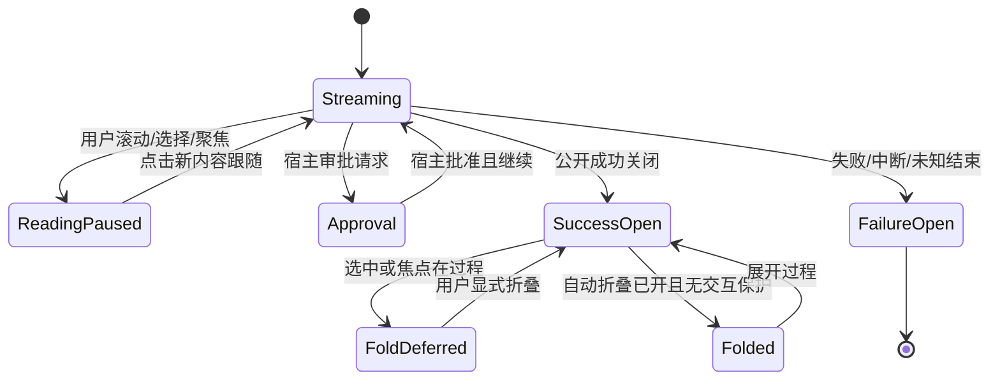
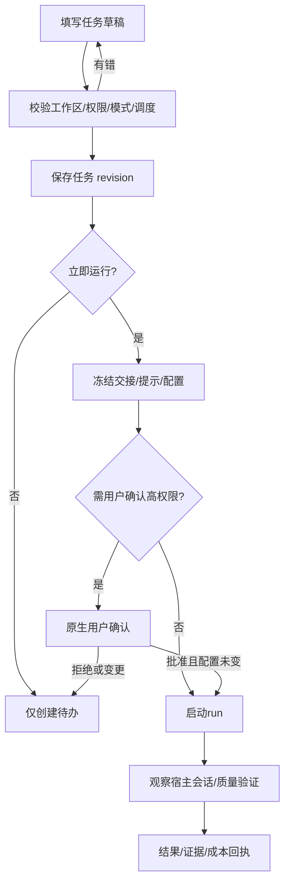
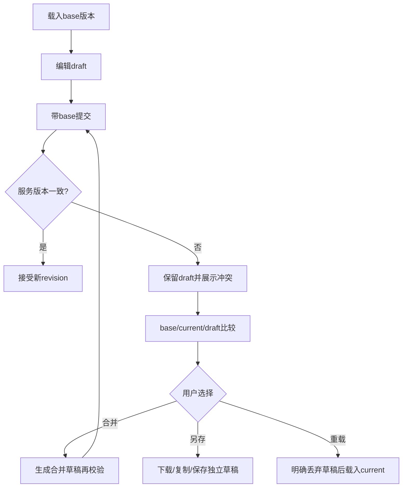
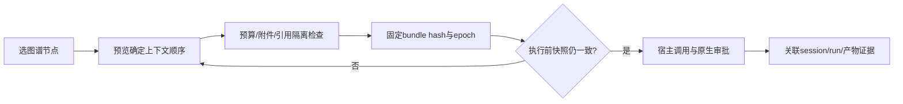
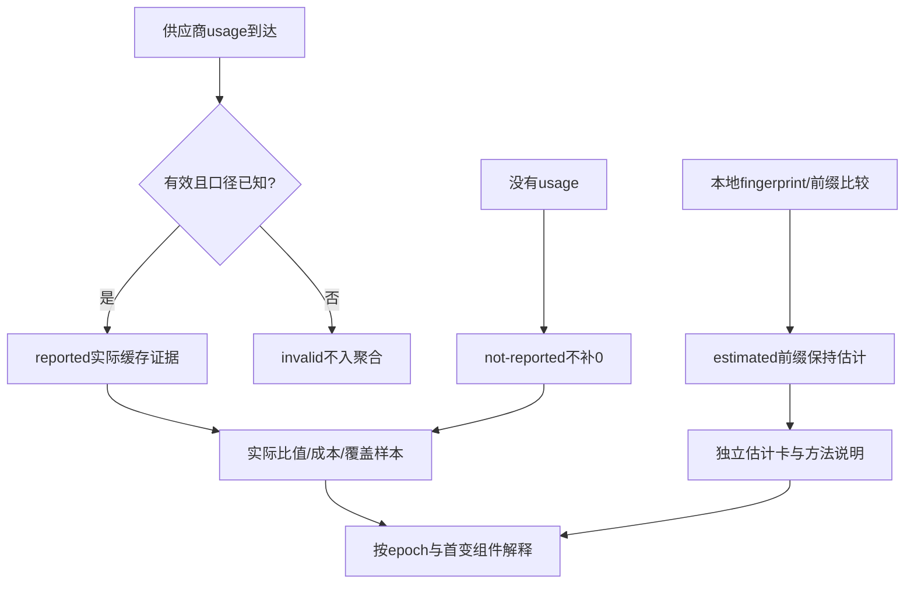

# 03 统一体验与界面实施规格

状态：规格基线，尚未实现。产品暂名 **DSH Nexus / 枢纽**，仅为本工程讨论名称，不宣称商标、npm 名称或注册身份。主工程目录为 `D:/dshplugin/plugin`。本章定义可直接交给设计、前端与测试人员实施的行为，不要求实现者先阅读来源研究。功能真源、数据与服务协议分别以记忆、工作流、上下文、运行恢复、缓存及宿主专章为准；当本章与专章字段名冲突，采用专章字段并同步本章，不默默提供两套。

研究结论见 `../research/03-ui-evidence.md`，Claude Desktop官方公开参考核验见 `../research/12-claude-desktop-reference.md`。**用户最新外观基线：插件内部整体完全参照Claude桌面客户端的布局、配色、排版、侧栏、居中会话/输入、右侧产物、模型选择和设置交互。** 本章已经替换原先深色青绿导航与仪表盘式首屏，后文全部功能页面均继承这一外观，不仅新会话首页换色。允许依法直接复用上游插件代码、控件、样式与协议。旧宿主 API 失效的功能本次必须恢复。`../design-preview.html` 是使用示例数据的离线交互概念稿，不是已连宿主的插件，也不是最终视觉验收。

## 1. 产品体验边界

枢纽向用户提供一个入口，组织原本分散的文件/Git/终端、阅读、记忆、画布、任务、审查、工程质量、技能/代理、用量、市场、远程与设置。它不创建第二份宿主会话，不截走原生审批，不以旁路模型调用悄悄完成原生操作。输入、发送、运行、取消与审批都绑定真实会话和宿主能力；投影缺失显示缺失，不凭 UI 推断出“运行成功”。

用户主要分为四类：持续编码者需要聊天与工程资源同屏；复杂任务负责人需要追踪计划、子任务、团队和质量门；长时项目维护者需要管理记忆、上下文、压缩与恢复；多设备用户需要在桌面、手机和远程连接中保持同一账本。设置者另需看到能力、兼容、凭据引用、许可和健康。默认首屏为Claude式新会话与居中输入，首访不要求完成向导才能读已有会话；工作台摘要进入轻量最近工作和对应领域页面。

以下术语必须一致：

|名词|界面含义|
|---|---|
|会话|宿主 session，以完整 ID 唯一；标题不是身份|
|派生会话|有可核实父关系的独立 session；不可把普通 tab 当派生|
|任务|任务账本实体；一次或多次运行可关联会话|
|运行|具有运行 ID、状态、开始/结束和结果的一次执行|
|管理状态|人手移动/分类的状态；不能冒充真实执行结果|
|工作区|宿主登记的根与身份；会话 cwd 可能在其子目录|
|资源|文件、技能、代理、预设、资产、模型配置等可寻址项|
|证据|有来源、时间、版本/快照、观测范围的记录|
|估计|本地推算或近似，必须带方法标签，不等于供应商 usage|
|配置 epoch|会话有效提示词/工具/记忆/压缩快照的稳定版本边界|
|Inspector|右侧详情面板；根据当前选择切换内容，不是第二个业务真源|
|能力|可独立启停和健康检查的模块；隐藏入口不等于卸载|

## 2. 宿主挂载、路由与页面所有权

原生页面与设置采用官方 React slots。插件只通过声明式 inject 使用可用的官方服务，不在运行时 require Harness Client 私有控件包；自有控件或许可允许复制后改为插件前缀的控件均可。样式对宿主只依赖公开 `--dsw-alias-*`，不得依赖宿主深层 class、DOM 兄弟顺序或私有 CSS 名称。slot 存在性、props 版本、epoch 与 disposer 必须按01章能力协商。

Claude一致性覆盖插件拥有的全部React表面，包括导航、对话阅读投影、输入适配表面、产物、任务、记忆、图谱、编排、工程与设置。插件自有token明确实现Claude暖白/石墨主题；公开宿主alias仅作为整合入口和高对比等环境语义，不能因DSH默认主题为蓝灰就自动将整个插件退回蓝灰仪表盘。用户选“Claude亮色/Claude暗色/跟随系统”控制本插件有效主题。宿主外层窗口标题栏、系统菜单、最小化/最大化按钮、原生窗口拖动区由Desktop所有；没有正式窗口/主题接缝时，不声称插件已经替换它们。所有可控内部视觉仍必须完成一致性，不能把窗口边界当作保留旧插件外观的理由。

禁止硬编码 `http://localhost:<固定端口>` 或假定 Desktop 页面与普通 Web 相同 origin。桌面使用 `dsh-app://app/` 及宿主提供的认证桥地址；所有 HTTP、WebSocket、文件与预览 URL 由宿主服务解析。普通插件管理/设置页不用 Host HTML iframe。MCP App、生成 HTML、Archify 或 thoughtdag 独立产物是受限预览例外，默认沙箱，权限与消息协议单独声明。

宿主会话列表与会话页仍由宿主所有。`layout.main`是keyed正式挂载点，枢纽在自己的main视图内部实现完整Claude shell、左侧导航和Artifacts面板；`layout.sidebar`是single且已被宿主使用，不可为达到外观而抢占它的根注册。宿主外层侧栏仅在有正式、经核验的collapse/布局接口时可折叠；没有该接口时保留宿主壳并在兼容说明中准确列出差异，不用全局CSS/DOM隐藏、不注入第二条宿主主侧栏。会话扩展、底部工作台和设置采用各自正式挂载点及能力协商。若宿主只允许一个中央页，则内部tabs承担路由；若允许多页面，路由仍使用同一身份和状态模型，不复制业务。单页路由示意如下，实际路径前缀服从官方插件路由 API：

|路由意图|主内容|主要选择身份|
|---|---|---|
|`overview`|工作台总览/当前会话入口|workspaceId、sessionId|
|`sessions`|会话检索与批量管理|sessionId、filterId|
|`tasks`|看板/列表/调度/执行图|taskId、runId|
|`memory`|库/检索/审核/演化|memoryId、revision、scope|
|`graph`|会话画布/思维/上下文路径|canvasId、nodeId、sessionId|
|`engineering`|文件/Git/审查/质量/工作流|workspaceId、resourceUri、checkId|
|`resources`|技能/代理/预设/模型/用量/市场|resourceKind、resourceId|
|`artifacts`|文档/代码/图形/网页等产物列表和右侧预览|artifactId、revision|
|`orchestration`|Metis角色编排、模型绑定、执行图和证据|runId、roleId、leaseId|
|`settings`|外观/能力/连接/存储/诊断/许可|sectionId|

客户端业务调用使用固定宿主连接服务路线 `ctx.connection.rpc.call('/api', 'nexus/rpc', NexusRpcRequest, signal)`。唯一项目payload为`{protocolVersion:1,method,scope,payload:NexusRequest}`，其中inner请求采用09章唯一`action/requestId/target/params/expectedRevision:number`包络；操作schema与作用域由领域专章声明。Host仅注册exact POST路由，不以共享intercept接管其他请求。HTML概念稿不是真实运行载体，不得作为一个Host HTML页面嵌进产品再冒称完成原生插件；页面交互需要落到React组件、正式slot和上述认证RPC。

内部链接必须编码身份与必要视图，不编码密钥、短期 pairing token、完整 prompt 正文或敏感搜索结果。收到旧路由时解析并跳到新落点，显示一次可关闭“入口已合并”说明；无法映射则显示原始资源类型和可手工搜索的 ID，不能跳错记录。

选择变更不保存草稿；保存是独立动作。编辑表单、代码和任务可有草稿，按用户+工作区+资源 ID 隔离；浏览宽度、折叠、排序为纯本地偏好；业务状态保存在宿主域。注销插件时取消订阅、关闭插件拥有的 channel、销毁 viewer 注册与 observer，但不终止用户明确托管给宿主的任务/PTY。关闭预览不等于取消运行；菜单要分别命名。

## 3. 总体布局与导航

桌面整体参照Claude：左边暖灰窄侧栏，中间安静的会话/工作内容，右边按需打开Artifacts式产物/详情区。侧栏顶部是Nexus文字品牌与折叠按钮，下方依次为“新会话”“搜索”，再为会话、工程/项目、产物、编排；任务、记忆、图谱、资源放同风格扩展组，全部可达。近期会话按标题行列出，底部固定当前工作区/用户菜单与设置。侧栏默认248px（可在232–280px中适应），收起56px；不使用深海军蓝反差栏、不铺满多套状态卡、不加独立76px企业后台顶栏。该导航属于Nexus自有`layout.main`视图内部。进入宿主原生会话页时只挂接已允许的局部扩展，不重新注册`layout.sidebar`根或再造一套宿主会话导航。

主区顶栏高52–56px，只有侧栏展开、当前标题/项目菜单、分享/产物/更多等必要操作。新会话内容居中最大宽760px，问候/展示标题与输入框形成首要层级；已有会话阅读列680–760px，左右留白随窗口伸缩。>=1440px产物区默认占剩余宽度的42–48%，最小420px，可拖拽至35–60%；对话不应因打开产物低于440px。1120–1439px产物为可固定侧区或主区切换；760–1119px侧栏默认收起，产物以同层tab/覆盖式抽屉出现；<760px侧栏变左抽屉，顶栏保留菜单/标题/产物按钮，产物为全屏页，输入框左右12–16px，所有能力通过抽屉与更多菜单可达。Claude式移动侧栏取代原先七个微小底部图标。五列任务在窄屏变状态tabs+单列，不缩成微型五列。

分割条宽 6px，拖拽可用，键盘左右/上下步进8px，Shift步进32px，有“恢复默认布局”。每会话记住右侧 tabs 与 dock 高度，每工作区记住工程文件和 Git 范围；全局主题和密度统一。达到最小宽度时自动切抽屉，恢复后不突然覆盖用户正在输入的内容。最小可操作窗口为360×640；横向代码允许独立滚动，主页面不能依赖整体横向滚动。

Inspector统一进入Claude式右侧面板，不同时堆三个抽屉。该面板顶层tabs为产物/编排/证据，可按选择增显文件详情；标题栏有名称、版本/只读/未保存状态、复制/下载/展开/关闭。产物内容与会话并列，文档白纸面、代码等宽、HTML受限预览，标题栏与页面间有细边界。选择任务显示任务详情，选择文件显示信息/历史，缓存显示证据；固定时新选择仅提示，不抢正在编辑内容。底部终端dock默认关闭，必要时在工程/会话下方展开，不占新会话欢迎页；有未读错误用数字，不持续闪烁。

全局搜索默认只搜当前工作区，用户可切“全部可见”。搜索结果分会话、任务、记忆、文件、技能/代理、图谱节点，不混为一个未标类型的列表。文件搜索、语义搜索、外部 Web 搜索是不同模式，明确网络与成本；缺 provider 时显示可配置来源。搜索中保留上一轮结果并标“更新中”，取消只取消当前查询。分组可折叠，每组显示已载/总量或“至少N”，未知总量不伪造数字。

## 4. 视觉系统与 token

外观完整参照Claude Desktop的暖白/石墨、安静侧栏、居中对话与输入框、衬线展示标题、干净正文、右侧Artifacts和轻量popover/设置modal。主会话不是SaaS仪表盘：首页不默认铺KPI、项目hero或多列卡墙，任务/用量指标进入对应页和按需证据区。所有业务页继承同一暖中性色和圆角/边框，不为工程、记忆、编排再造蓝绿主题。壁纸/宠物/玻璃默认关闭；资产可用但不得压过Claude视觉基线、正文与关键状态。

生产组件只消费`--nexus-*`；主题适配层对宿主只读取已存在的公开`--dsw-alias-*`，不臆造具体alias名、不写宿主根变量。插件的Claude主题scope用下列固定设计值（官方公开品牌CSS的暖白/石墨/陶土色可核实，精确Desktop像素是本工程设计值而非登录后实测），把宿主环境颜色映射为兼容/高对比语义。用户明确选择Claude主题时，这些插件自有设计值是生产主题，不只是预览fallback。若宿主别名不足，使用自有scope保持设计并记录诊断，不跨边界篡改原生窗口壳。

|插件 token|Claude亮色设计值 / 语义|Claude暗色设计值|用途|
|---|---|---|---|
|`--nexus-bg`|主会话暖白 / `#FAF9F5`|`#262624`|会话与主区|
|`--nexus-sidebar`|暖灰侧栏 / `#F0EEE6`|`#1F1E1D`|左导航、近期会话|
|`--nexus-surface`|输入/菜单容器 / `#FFFFFF`|`#30302E`|输入框、菜单、数据面|
|`--nexus-surface-raised`|抬升容器 / `#FFFFFF`|`#353532`|设置modal、popover|
|`--nexus-surface-muted`|弱容器 / `#F5F4ED`|`#2B2B28`|用户消息、分组|
|`--nexus-text`|石墨前景 / `#141413`|`#F0EEE6`|正文|
|`--nexus-text-muted`|次要前景 / `#5E5D59`|`#C2C0B6`|辅助说明|
|`--nexus-text-faint`|低强调前景 / `#73726C`|`#B0AEA5`|时间/路径|
|`--nexus-border`|细分割 / `#DEDCD1`|`#4D4C48`|边框、分割|
|`--nexus-accent`|陶土强调 / `#C46849`|`#DE977A`|发送、品牌点缀、焦点|
|`--nexus-accent-soft`|弱陶土容器 / `#F3E9E2`|`#46362F`|少量选择/提示|
|`--nexus-selected`|中性选中 / `#E8E6DC`|`#3D3D3A`|侧栏当前项、tab|
|`--nexus-success`|已证实成功 / `#426B50`|`#9CC6A5`|成功文字+图标|
|`--nexus-warning`|需注意 / `#8A601D`|`#DCC08B`|待审核/覆盖缺口|
|`--nexus-danger`|危险 / `#B34339`|`#F0A197`|破坏/错误|
|`--nexus-info`|中性信息 / `#496B8D`|`#A1BFDA`|非品牌状态|
|`--nexus-focus`|可见焦点 / `#A84F34`|`#E5A68D`|2px环+2px间隔|

间距采用4/8/12/16/20/24/32/40/48px。侧栏行32–36px，左右10–12px；正文留白最大化并保持会话列对齐。首页输入容器高至少150px，圆角20–24px，内边距16–20px，下方左附件/能力、右模型菜单/发送。普通按钮圆角8、sidebar选中7、产物容器12、设置modal16；细描边1px，输入框仅极浅阴影，普通功能区不用重影/渐变。状态pill不铺满一整行，重要缓存证据保留简短可展开文本。

排版参照Claude的展示衬线与功能无衬线组合。新会话问候/欢迎标题采用Georgia、已授权本地CJK衬线或系统宋体，桌面38–44px/1.2/400，窄屏30–34px；普通页面标题可用26–30px衬线，复杂数据表/工具标题使用干净无衬线16–22px。导航、按钮、菜单和设置正文用系统sans；会话回答正文15–16px/1.8，用户消息15px/1.65。代码/ID用monospace13px。不得下载/打包未获授权的Anthropic专有字体，不因此取消衬线层级，用本地替代保持字面比例与留白。较小元数据不能承载唯一关键结论，精确金额/币种/口径保留。

暗色主题不是反相：代码色、diff、图谱边、选中背景、错误和分隔分别验收。高对比遵循系统/宿主偏好，减少半透明和阴影，以实体边界区分。状态同时有文字与图标，色弱下可识别；图表系列另用线型、点形、标签。动画100–180ms为主，只帮助定位变更；prefers-reduced-motion关闭滑动/计数/闪光，忙状态用静态文字或低频进度。后台 tab 直接落到最终状态。

## 5. 基础组件契约

|组件|必须行为|禁用/错误/无障碍|
|---|---|---|
|ActionButton|主动作每区域最多一个；异步显示具体动词；支持取消时旁列取消|busy不清空文字；disabled提供原因；图标按钮有名称|
|ClaudeComposer|居中大输入、附件/能力入口、执行方式、模型popover、发送；保留原生草稿/审批语义|不是第二发送管线；IME不误提交，运行中状态明确|
|ModelPopover|provider/model/说明/支持effort/作用范围/可用态/当前勾选；可搜索|未知价不写免费；角色模型不改变主会话run租约|
|ArtifactPane|右侧并列、标题/类型/版本、预览/源码、复制/下载/展开/关闭|敏感内容按权限；dirty关闭保护；窄屏独立全屏页|
|OrchestrationRoleRow|角色/owner/任务/依赖/模型binding/effort/lease/状态/证据/预算|模型候选不越池，unknown与unmeasured独立，路由变化预览成本|
|CommandPalette|按类型分组，最近/当前上下文，快捷键，输入法完成后搜索|ESC依次清查询/关面板；不在输入拼音时执行命令|
|ScopePicker|工作区/项目/分支/个人分层，展示真实 scope|未知分支标未知；不同scope不按同标题合并|
|DataTable|排序/筛选/分页、固定关键列、逐行状态、选择统计|空结果和空数据不同；跨页选择显示隐含选择数|
|TaskCard|标题、来源、状态、tag、运行与下一计划、权限摘要|拖动不伪装执行；运行锁定显示可行替代|
|StatusBadge|枚举文本+图标，tooltip有时间/来源|不以绿色代表“未检查”；unknown独立|
|EvidenceBadge|reported/estimated/not-reported/invalid四态|estimated不可短写成“命中”；无数据不显示0%|
|EpochChip|简短版本+变更点，展开四个epoch/哈希摘要|不暴露完整prompt；复制只复制非敏感标识|
|CodeEditor|读写/脏/只读/编码/换行/大文件分页、搜索|保存冲突保留草稿；二进制不当文本写回|
|DiffViewer|左右/统一，准确端点/版本/文件身份、跳行|outdated状态禁止误套修复；无法定位显示原因|
|Tree|虚拟化/惰性/展开/多选/刷新、Git状态|加载失败留子树与重试；symlink明确标识|
|GraphCanvas|平移/缩放/聚焦/键盘节点/路径列表替代|大图渐进加载；错误节点局部失败；不要只依赖拖拽|
|Inspector|固定/关闭/深链/字段操作/相关记录|焦点返回触发项；脏表单关闭需保留或确认|
|SecretField|写入新值、已配置状态、来源/最后变更|永不回显现存密钥；清除独立动作并验影响|
|HostTerminal|宿主PTY、tabs、退出/连接状态/复制|插件不私建PTY；close与kill不同|
|OutputLog|stdout/stderr分开、实时/暂停、搜索、截断说明|不用innerHTML渲染ANSI外文本；可导出已脱敏日志|
|MCPFrame|来源、轮次、初始化/resize/submit、关闭|受限sandbox、拒绝无效origin/消息、独立错误面|
|Toast/Notice|短暂结果/长期阻断分开，有关联记录|错误不只闪一次；屏幕阅读器不重复洪泛|
|Skeleton/Empty|布局稳定；空态说出条件和可行动作|失败不用空态假装无数据；重试带范围|
|Confirmation|对象、影响、可恢复性、具体按钮文案|不把通用“确定”用于级联删除/外发/提权|

表单默认“标签—字段—帮助—错误”顺序。必填写“必填”，不只红星；错误在字段旁和顶部摘要同时出现。长表单折叠分组展示有效摘要，组内错误自动展开并跳焦点。输入脏后不能因后台刷新覆盖；自动保存仅用于明确标记的偏好，不用于秘密、任务运行参数、Git提交、记忆合并或破坏动作。

## 6. 工作台与聊天阅读

工作台首屏完全采用Claude式新会话构图：低密度顶栏、暖白大留白、居中衬线问候、宽输入框、紧邻的少量动作建议，以及下方简短最近工作。工作区/运行状态在标题与侧栏小标签呈现，缓存用输入下方的一行可展开证据摘要；不默认展示三张KPI、巨型目标hero和右侧常驻统计卡。点击“继续最近会话”进入对话，“编排一个任务”打开Metis编排草稿，“打开工作区”打开原生工作区选择。待处理审批/记忆候选聚合为低噪声入口，不铺多套卡片。所有内容来自领域投影，不显示杜撰趋势。

输入框是本页视觉核心：多行textarea、占位说明、附件/工具按钮、执行方式菜单、模型下拉与陶土色上箭头发送按钮。模型下拉显示provider/model、说明、可用/不可用、已声明effort、继承范围；主会话与角色选模明确分开。弹层宽300–340px，可搜索，分组来源，当前项勾选；切换只变下一轮/新run的草稿有效态，已运行租约保持冻结。任务状态/缓存/权限元数据不塞满输入边界，能展开查看。

产物卡在回答中以文件图标、名称、类型、版本与打开箭头出现。点击后右侧Artifacts式区展开，不另开全屏后台；对话与产物保持同一会话关联。产物header有预览/源码（适用时）、版本、下载/复制/扩大/关闭；Markdown等编辑遵循base版本协议，代码/HTML只在明确模式编辑或执行。产物区的“编排”tab承载Metis角色、依赖、模型与预算，“证据”tab承载来源/质量/缓存；不是照搬Claude不存在的功能名并声称原产品已有。

进入原生会话后的阅读模式默认可开，原始轨迹一键回看。消息顺序、文字、空白、block identity、附件顺序、reasoning字面内容必须保真；未知block使用原生fallback并显示“由宿主呈现”。不重写推理内容，不复制相同旧文本制造流式效果。只对新增grapheme进行轻微出现动画；复制始终取原始内容，不复制装饰字符。

自动折叠只在宿主公开“该轮成功关闭”事件后触发；失败、中断、等待审批、unknown结束保持展开。用户选中或聚焦过程内容时延后，解除后也不能突然抢滚；显示“过程可折叠”控制。折叠摘要含步骤/工具/耗时，有“展开本轮”与“全部展开”；展开状态按会话本地保存。历史完成轮默认静态，重新选择会话不重播所有动画。

流式跟随仅在接近底部且用户未主动滚动时启用；wheel/touch/选择/focus进入阅读暂停。出现新内容时给“↓ 新内容”按钮；点击恢复，不自动强拉。代码块横向滚动不触发主列表跳转。输入区、审批和模型/effort不被阅读层遮挡；审批卡可在顶部待办提示中定位，但确认仍进入原生对应请求。

模型与执行配置显示模型来源/模型名、已声明的reasoning effort、PTC或native、预设、权限档与有效epoch。改变设置先说明作用于当前下一轮还是新会话；高权限变更必须用户手动确认。运行中可编辑下轮草稿但不偷偷重启当前轮。每个请求可从元数据打开上下文/缓存Inspector，默认不展开长prompt。

右侧“侧聊”显示父会话、继承种子时间/压缩边界、独立模型和状态。创建时用宿主有效上下文快照；无法继承则明确拒绝或让用户选空白会话，不能假称完整继承。消息队列含顺序、排队原因、可撤销；发送前按本线程权限。提升顶级会话后有可核实新身份/关系，原入口保留重定向。取消队列项不取消已运行的其他项。

```text
┌ 暖灰侧栏248 ┬──────────────────── 主会话 ──────────┬ 产物 / 编排 / 证据 ┐
│ Nexus  [收起]│ 规格与体验设计 ▾           [产物] ⋯ │ 03体验设计  v7  ×  │
│ + 新会话     │                                     │ 预览 | 源码 下载  │
│ 搜索         │       用户消息（浅暖灰容器）         │                   │
│ 会话/工程    │                                     │ 独立文档/代码/图形│
│ 产物/编排    │       原样回答，居中阅读列           │                   │
│ 任务/记忆    │       [文档产物卡 ↗]                │ 选中角色的模型    │
│ 图谱/资源    │                                     │ 路由/证据/缓存    │
│ 近期会话…    │  ┌────宽输入框，圆角20───────────┐   │                   │
│              │  │继续讨论…                     │   │                   │
│              │  │+ 工具   方式▾  模型/effort▾ ↑│   │                   │
│ 工作区/设置  │  └──────────────────────────────┘   │                   │
│              │  缓存：供应商报告64.2% · epoch ▾    │                   │
└──────────────┴─────────────────────────────────────┴───────────────────┘
```

## 7. 会话管理与恢复入口

会话页列出全部授权可见会话，包括空白、无工作区、子代理和元数据不完整项。列为标题/短ID、工作区、关系、运行状态、最近活动、归档状态、大小/后代数、异常标记。缺标题显示“未命名会话”，缺工作区显示“未关联”，未知archive时间不得显示今天。搜索title/fullID，筛选活动/归档/工作区/关系/异常；排序基于稳定字段，刷新不打乱用户正在操作的选择。

选择跨分页保留，工具条写“已选择23项，其中6项在当前筛选外”，提供“清除筛选外选择”和“仅当前页”快捷项。批量归档/恢复/删除前固定目标快照；确认页显示直接项、级联后代、合计、受保护跳过项和预计可回收空间。当前/运行中/有运行后代整族保护。操作按行流式回执；失败可重试失败项，不能把已成功项重复提交。不知道空间则写未知。

删除和归档不是同一动作。归档可恢复，永久删除需明确不可恢复性与级联；自动规则默认关闭。自动归档按真实最近活动，自动删除按真实记录的归档时间，unknown时间永不自动删除。规则预览显示“若现在运行”的匹配与保护数，保存规则不等于立即执行。设置者可手动运行，并独立确认本次目标。

会话详情含完整ID复制、父/子关系、cwd、工作区、模型、最后活动、有效epoch、相关任务/图谱/产物/恢复点。剪贴板失败保留只读可选择文本，不能只报错。恢复页区分会话恢复、turn rewind、画布快照、文件回退和压缩范围恢复；每项说明会影响什么、哪些副作用无法撤回、当前执行是否允许。没有快照时不能显示可点击“回退成功”。恢复行为以运行恢复专章为准。

```text
┌ 会话 ────────────────────────────────────────────────────────────┐
│ [搜索标题 / 完整 ID                 ] 工作区▾ 状态▾ 异常▾ 排序▾│
│ 已选择23项（筛选外6）       归档  恢复  删除     自动规则(关闭)  │
├─┬ 标题 / ID ─────────────┬工作区──┬关系──┬活动───┬归档──┬大小───┤
│✓│ 统一插件规格 / a12…    │plugin  │主会话│运行中 │未归档│2.4MB  │
│✓│ UI研究 / b34…          │plugin  │子代理│已完成 │已归档│812KB  │
│ │ 未命名会话 / c56…      │未关联  │未知  │未知   │未知  │未知   │
├─┴────────────────────────┴────────┴──────┴───────┴──────┴───────┤
│ 结果23/156 · 继续加载            [右侧详情：完整ID/族/恢复点]   │
└──────────────────────────────────────────────────────────────────┘
```

## 8. 任务、调度、子任务与 GitHub

任务页提供看板/列表/执行图/日程四个视图，共享同一筛选：项目、来源、负责人、tag、运行状态、管理状态、调度、归档。看板五列规划/待办/运行/完成/失败保留原习惯；手动拖入完成只修改管理投影，有“手动归类”标识，不能生成成功run。运行锁定卡不可直接拖回待办；用户应取消/等待后再管理。归档任务只读，允许恢复、删除和查看transcript。

卡片显示标题、来源（手动/GitHub/子任务）、最多3个tag其余+N、当前运行、上次结果、下一调度、子任务进度、权限/工作区异常；描述最多两行，完整内容放详情。状态与来源不能只靠颜色。运行卡显示真实开始时间与取消入口，进度未知显示“执行中”，不能循环一个假百分比。列表可显示更精确列；执行图连父子/依赖/团队消息而不混淆关系。

新建/编辑任务采用分组抽屉：内容、标签、执行、协作、交接、调度、高级。每组折叠摘要含有效值和错误数。标题必填；description与executionPrompt分离，executionPrompt可选，标注仅执行范围。AI粘贴解析先显示输入与将填写字段，45秒可取消，只填表不自动提交；失败保留原文与既有值。slash命令不得混入冻结continuation输入，错误定位到字段。

执行配置必须显示固定工作区/预设/模型/effort/权限/模式，并注明继承来源与override。父任务默认继承可逐项覆盖；深度默认1、最大3、无环。子任务组并行执行，done项跳过，任一失败组失败，不能把部分成功显示整体成功。AgentTeam是可选明确模式：一名lead、多teammate，宿主不可用明确拒绝，不静默变成普通subagent；权限不一致先解决再启动。

目标运行开关是双重条件：全局goalRunEnabled默认关，任务goalRun意图默认也要清楚展示；只有两者有效才允许目标运行。卡片“目标模式待启用”不能等于运行。质量验证默认开，摘要展示三维判定与总分阈值、两次A/B交换/零工作基线的结果来源；不能把分数包装成通用最佳质量承诺。未通过有可定位反馈、花费和重试次数，用户可取消。提高权限需用户独立确认，代理不得自行代确认，配置变化使旧确认失效。

交接快照固定goal/progress/nextStep、timestamp/source，相关文档/脚本只存引用与版本；敏感字段脱敏、大小上限8KiB。查看“当前草稿”和“本次冻结快照”可并排比较；执行后编辑任务只影响下次，不重写历史run。任务历史最近20次为初始窗口，可继续加载，未知旧历史不伪装删除。

调度编辑器含五字段cron、时区、自然语言解释、未来5次预览、runlimit、一次性开关、misfire策略。解释Vixie day-of-month与day-of-week的OR语义；DST不存在时间跳过、重复时间仅较早一次；默认misfire跳过，不补发风暴。停止调度不取消正在run，界面分别提供。启动恢复若发现已知session则观察，不重发；找不到session则标“启动未确认/已取消”，给新建运行按钮而不是自动再发。

GitHub来源任务显示repo/issue、纳入原因（label/assignee/真正未分配）、远端状态与同步时间。初次执行冻结issue内容；手工executionPrompt不被同步覆盖。AI分析标“未审核”，按内容hash缓存且不能替代原issue。PR创建/链接/评论/关闭分别显示目标和最终文本；关闭issue仅在已验证PR merged后允许。标签仅修改插件自有prefix，不改仓库原标签。远端不再匹配则停用来源并保留历史。凭据显示配置来源与测试结果，不回显token。

```text
┌ 任务    看板 | 列表 | 执行图 | 日程 ────────────── 搜索  新建任务 ┐
│ 项目▾ 来源▾ 标签▾ 负责人▾ 已归档□              运行中3 · 待审批1 │
├ 规划(4) ───┬ 待办(6) ─────┬ 运行(3) ──────┬ 完成(12) ┬失败(1)─┤
│┌──────────┐│┌────────────┐│┌─────────────┐│…        │┌────────┐│
││ 整合规格 │││ 缓存口径   │││ UI规格      ││         ││构建失败││
││ 手动 ·文档│││ GitHub #42 │││ 子任务2/4   ││         ││重试详情││
││ 目标待启用│││ 待审核分析 │││ 运行18m 取消││         │└────────┘│
│└──────────┘│└────────────┘│└─────────────┘│         │          │
├────────────┴──────────────┴───────────────┴─────────┴──────────┤
│ 选择卡片→Inspector；拖动只更改管理状态，执行结果由真实run记录   │
└────────────────────────────────────────────────────────────────┘
```

```text
┌ 任务详情 / UI规格 ────────────────────────────────── 固定  关闭 ┐
│ 运行中 · run_7   来源：子任务         取消运行   查看会话      │
│ 内容▾  目标/说明/标签                 [有未保存草稿]          │
│ 执行▾  工作区plugin · 模型M · effort高 · 标准权限             │
│ 目标运行：全局关闭 / 本任务开启 → 当前无效                    │
│ 协作▸  普通子任务 · 继承4项 · 覆盖1项                         │
│ 交接▸  已冻结 19:20 / 2.1KiB / 有来源                         │
│ 调度▸  未启用  [设置cron/时区/下次5次预览]                    │
│ 历史  本次运行 | 上次结果 | transcript | 质量门               │
│ 质量：incomplete · 覆盖缺口2 · 新阻断1             查看证据   │
│                                      放弃草稿   保存下次配置 │
└───────────────────────────────────────────────────────────────┘
```

## 9. 记忆中心

记忆页不能把八种记忆产品压成一个没有来源的“笔记”。统一入口提供库、检索、候选审核、演化/维护、同步/导入五个子页；用户级、项目级、路径触及、分支、主体、时间与外部引擎各有显式scope。基础离线文件记忆随时可用，高级Python、向量、HTTP服务按capability启用；缺引擎只阻断对应能力，不让整个记忆页白屏。

库左侧按个人/工作区/路径/分支分组，主表显示标题、类型、scope、状态、验证、来源、最后更新、是否注入、revision。相同标题不跨scope自动合并。用户可搜索标题/标签/正文，切关键词/语义/时空检索；结果显示命中片段、路径、引擎与排名依据，不能把相似度当真实性。条件不满足、负条件拒绝、blindspot与未检索到是不同结果。

详情提供原文、结构化六要素（适用时）、生效条件/不适用、依赖、双时间轴、验证证据、来源会话/文件、注入预览、历史、保护/tombstone。自由文本不用强制六要素；高级结构要求由类型/策略声明。unverified/verified/doubted/expired/rechecking与检索ACCEPT/REJECT/DEFER/BLINDSPOT、写提案ACCEPT/MERGE/DROP/DEFER是三组不同状态，标签颜色可相近但文字不可混用。

新增表单先选scope与类型，再填title/content/tags/path/branch。高置信凭据形态拒存，说明字段且不把秘密再写入错误日志。编辑采用base revision；外部文件修改使内容stale时保留草稿，给比较/合并/另存草稿/重载，不能覆盖手工外改。同主题更新必须显示将替代的具体条目。自动超容默认提示/归档候选，不静默删除最老记忆。

候选审核显示建议来源（真人反馈/模型归纳/导入/主动学习）、证据、将影响的scope、注入变化与成本，逐条accept/reject/edit/merge/noop，批量仅在策略允许时。编译者不得自证验证，外部attest明确主体/时间/依据。高重要性、anchor/self和protected条目不被普通遗忘绕过。遗忘/维护先dry-run呈预演、依赖传播、受保护跳过，再apply；回滚展示哪些变更可逆、哪些外部动作不逆。

演化视图提供账本、规律/缺条件、校准/盲区、因果/预测、状态卡、近期事件、时空关系、引用索引、协议peer、沙箱推演、维护固化。高级操作按目录检索可达，不把全部按钮挤在首屏；每个action显示只读/写/管理级、输入、预演与回执。状态卡引用任务/会话，不生成第二份任务真源。依赖变动先标疑，自动传播与多跳apply以专章协议为准。

同步页每项目独立opt-in，显示仓库身份/分支/稳定entryID、上次同步、ahead/behind、冲突、离线。全局启用不等于所有项目授权。冲突按三方版本展示，不用“最新版覆盖全部”。导入支持原记忆格式、Markdown/JSONL/目录等能力，先解析计数/冲突/秘密扫描/来源，再选择导入；可恢复归档，tombstone保留历史。导出标范围和脱敏选项。

```text
┌ 记忆     库 | 检索 | 候选审核(3) | 演化维护 | 同步导入 ───────┐
│ [关键词 / 条件 / 语义检索         ] 范围▾ 状态▾ 新增记忆    │
├ 范围树 ───────┬───────────────────────────────┬ 记忆详情 ────┤
│ 个人          │ 标题 / 类型 / scope / 验证      │ 项目规范     │
│ 项目plugin    │ 项目规范   条件 · 已验证        │ revision12   │
│  └src路径     │ 编码偏好   自由文 · 未验证      │ 生效/不适用  │
│ 分支main      │ 构建陷阱   负记忆 · 受保护      │ 证据/依赖    │
│ 高级引擎      │ [候选不会混入已注入内容]        │ 注入预览     │
│ 外部服务(离线)│ …                              │ 历史/编辑    │
├───────────────┴───────────────────────────────┴──────────────┤
│ 已注入快照m17 · 待采纳3 · 当前检索：文件+高级本地              │
└──────────────────────────────────────────────────────────────┘
```

## 10. 图谱、上下文与会话画布

图谱页包含会话分支画布、思维/材料图、上下文路径、团队拓扑、结构导出。不同边用类型区分：会话派生、材料引用、上下文继承、任务依赖、代理消息；不能画一根相同线让用户猜。节点显示类型、标题、来源、状态、时间、正文是否完整/截断。点击只选择，双击或明确按钮打开；不因hover加载敏感全文。图谱用宿主session为真源，画布坐标/颜色是插件数据。

用户可新建节点、连接/断开、编辑材料、选多个节点构建上下文、选择祖先路径、fork已完成turn、继续会话、导入导出、合并来源高光与Weave、生成思维图/旅程结构图、启动实验handoff。每条能力须展示真正可用的操作，而非只有一个占位“未来支持”。依赖旧日志格式的读取先按官方projection；历史文件回填显示近似/缺失，不能伪造完整内容。

上下文构建器以确定顺序展示material/reference/conversation，引用区与执行指令分离，附件不被误复制为正文。预算条写方法：宿主准确计量/供应商report/字符估计，超预算逐项排除，保留原因和用户选择。构建后显示bundle hash和选中节点，真正调用前检查快照未变；晚到请求按run token丢弃，避免旧结果覆盖新选择。

凝练/压缩采取预览→新副本/新节点→重新连线；默认不毁原链。范围解压显示CCR或等价范围、imageRef恢复能力、父链只读深度与实际可恢复内容。缺少恢复能力时移除相应“可恢复”声明，同时给全文导出/其他恢复方案；不能让按钮显示成功但缺附件。引用循环由visited去重，环被可视标出且不无限展开。

团队拓扑展示lead/teammate/subagent、各自session/run/task、消息有事件证据、运行与时间。没有host agentTeam投影时显示“不可用/未报告”，不把普通子代理推定成团队。节点数大时按分组/视窗渐进加载，提供表格替代、按ID定位、折叠和“聚焦当前路径”；导出图可选无正文结构，敏感内容默认不包含。

```text
┌ 图谱 / 当前项目   画布 | 上下文路径 | 团队 | 导出 ─────────────┐
│ 搜索节点   类型▾  来源▾  仅当前路径□   100%  聚焦选择  新节点 │
│ ┌根会话S1───┐      ┌材料M2────┐             Inspector         │
│ │原始目标   │ -引用→│规格约束  │             节点类型/来源     │
│ └────┬──────┘      └────┬─────┘             完整/截断/状态   │
│    派生│                引用               上下文组成        │
│ ┌────▼──────┐    ┌─────▼─────┐             预算与证据        │
│ │会话S2     │───→│凝练副本M3 │             fork/续聊/编辑    │
│ └───────────┘    └───────────┘             原生审批入口      │
├──────────────────────────────────────────────────────────────┤
│ 选中3节点 · 估计12.4k token · bundle h21   预览上下文  执行   │
└──────────────────────────────────────────────────────────────┘
```

## 11. 工程：文件、预览、Git、终端与远程主机

工程页子tabs为文件、Git、审查、质量与工作流、主机；底部可开终端/输出。文件侧树保留惰性加载、watch、Git着色、多选、搜索、拖放上传、创建/重命名/删除、zip下载、Open with与编辑。路径始终相对明确工作区，Inspector可看解析后的绝对路径/链接目标/大小/编码/权限；不同cwd同相对路径不可混用。外部文件要显示边界与授权，不能通过树导航升级权限。

拖放先显示待上传列表、目标目录、重名策略、大小与来源；不能默认覆盖同名。批量删除确认列对象/目录递归影响、可恢复性；失败逐项回执。重命名失败保留原名与输入，树watch不会把用户输入吞掉。全局搜索区分文件名/内容、case/regex、ignore与范围，结果有路径/行/截断；取消停止本次查询并保留已有结果。打包zip有构建/进度/下载/失败/过期状态，超限说明，不把尚未构建的按钮命名“已下载”。

编辑器支持代码、Markdown/Mermaid/大纲、JSONL卡片、HTML沙箱；图片/PDF/二进制由宿主preview能力。Office或音视频/Jupyter等仅在对应capability已存在时集成，缺时显示支持边界和系统应用Open with，不能承诺本插件实现不存在的格式内核。大文件默认分页/分片与只读保护，用户主动载入或转外部编辑；文件写回保留编码/换行与base hash。HTML预览严禁默认same-origin，外部网络/表单/脚本能力有明确状态；源HTML不能执行宿主动作。

Git页面上方为仓库/分支/worktree/远端和工作区范围，左列Merge/Staged/Changes，主区diff，右区详情。提交表单显示已暂存项、message与可选AI Generate；生成只填草稿，用户检查后commit。模型选择与估计成本可见。stage/unstage、discard、commit、pull/push、checkout、revert、cherry-pick都是独立动作，有真实结果；discard等破坏动作确认具体文件与范围。冲突提示显示进行中操作与可行继续/中止入口，不任意自动解冲突。

提交图只读浏览，200条初页、继续加载、branch/ref过滤与提交详情；过滤不checkout/fetch。无tags或其他数据时说明。历史操作放独立菜单且走正确安全边界，不把双击分支当checkout。worktree管理列managed/主树/路径/分支/dirty/占用；create选基线与名称，创建后注册工作区再新会话；删除脏树再强确认，是否删branch opt-in，主树不可删。checkout作用于工作区会影响其他会话，执行前列受影响session，不迁移当前session cwd。

“本会话AI变更”透镜只标可归因观测，不宣称全工作区所有diff都由AI生成。审查跳转保持端点/hash和准确行证据；读辅助文件不等于主审覆盖。底部终端可多tab、split、目录/会话绑定、复制、重新连接、退出码；宿主PTY缺失时明确不可用，不带私有PTY。后台job显示pid/所属会话/命令摘要/起止/输出/exit/截断，force-kill确认影响；关闭输出tab不杀job。

主机页含分组/环境tag/搜索、CRUD、认证测试/批量测试、SSH config Include导入预演。认证选password/key/agent/passphrase，ProxyJump多跳/ProxyCommand可表达；凭据写入宿主secret store，已配只显示引用/来源。forwardAgent默认关且解释风险。认证变化显示将断开的连接/转发数，确认后旧池失效。终端、SFTP、exec、转发、cluster五个子功能保持可达：stdout/stderr分开，默认60秒和输出cap明确；SFTP upload/download进度、失败重试、远端路径；端口转发仅本地监听，list/stop；cluster并发默认8，可按环境选主机。远程客户端不能用本地-only操作时显示准确原因与桌面入口。

```text
┌ 工程  文件 | Git | 审查 | 质量与工作流 | 主机 ────────────────┐
│ 工作区plugin ▾   搜索文件/内容     +文件 +目录 上传 下载ZIP   │
├ 文件树 ─────────┬ README.md × | index.ts ● | 预览 ───┬详情───┤
│ v src           │ 1  import …                        │路径   │
│   index.ts M    │ 2  …                               │revision│
│   client/       │                                    │Openwith│
│ v specs         │ [Markdown / Mermaid / CodeMirror]  │历史   │
│   03-ui.md      │                                    │关联   │
│ [惰性+watch]    │ 已修改 · UTF-8 · LF · 外部已变化⚠   │       │
├─────────────────┴────────────────────────────────────┴───────┤
│ 终端1 | 作业(2) | 输出 | 问题(4)          主体：当前宿主PTY   │
└──────────────────────────────────────────────────────────────┘
```

## 12. 工程：审查、质量与开发工作流

审查选择Git当前worktree/staged/unstaged/历史端点、SVN当前/历史/分支、全项目当前态，不混用范围。先preview固定端点/版本/hash/规则/模型/预算/网络读取授权/覆盖清单，再execute。预览不是执行成功，已读辅助上下文不等于完成主审。SVN网络历史先明确读取范围，不把授权变成update/checkout/merge。运行页有queued/running/cancelling/cancelled/succeeded/failed/timed_out/interrupted，取消后保留已完成证据与消费。

结果默认聚焦可行动发现和覆盖：严重度、路径/精确行、触发条件、影响、证据、建议、核验状态、new/existing/resolved/moved/uncertain。零发现仍展示completed/partial/excluded/blocked/pending覆盖，不把partial画成全绿。代码变更后outdated，重新定位仅按许可协议的唯一精确文本，不能跨文件模糊套行。查看回执可见文件身份、侧、版本、hash、行窗口、模型纠错次数与来源；导出含范围/局限。

质量与工作流首页默认显示差分摘要、新阻断问题、覆盖缺口、质量门，再显示全量历史。质量档案有工具/版本/配置签名/规则包/覆盖缺口，能区分配置未找到、工具未装、运行失败和没有问题。顶部固定显示scope、snapshot、profile epoch、fresh/cached/mixed、原执行时间、当前重核时间与stale原因。检查计划按scope和层级，允许预览命令/配置、运行/取消/重跑必要范围，不未经用户任务授权自动修改全仓。质量诊断差分枚举采用08章的new/resolved/unchanged/moved/suppressed/out-of-scope/unknown，不把审查发现自己的归类枚举直接充当lint诊断。诊断有规则详情、理由、定位、来源、归类历史，窄例外必须有scope、原因、owner、到期，不用全局关闭规则解决单条问题。

修复流程先planId与diff预览，显示语义风险、受影响文件、检查依赖与冲突；批量修复按事务分组，apply前再核base版本。冲突保留计划与草稿，不强写。修复后跑与变更相称检查，回滚有事务回执；格式化成功不等于功能测试通过。质量门五态固定为pass/fail/incomplete/stale/waived；waived显示批准者/理由/到期，不与pass同色同文案；缓存复用显示核验快照/时间/失效原因，不把reuse叫fresh。

工作流实例显示change类型、phase、状态、owner、上游依赖、输入/输出制品和证据。状态draft/ready/running/needs_input/blocked/completed/cancelled；phase、approval、execution是三组正交状态，不能把“人已确认”显示为“实现已完成”，阶段进度不自动等于验收/发布。支持需求、设计、计划、实现、验证、独立冷读审阅、交付等可配置阶段；每阶段开关由方法包/工程策略声明，UI不凭装饰进度自动越门。文档制品包含需求/设计/计划/PR草稿/README/CONTRIBUTING/ADR/SVG，以真实文件/版本链接为准。冷读问题显示提出者、具体证据、处置与复核，不能让作者点一下就冒充独立审查。

方法/代理目录把Aegis、Superpowers、agency、J-Space、OPS等能力作为有来源的可选资源，说明内容/工具/流程/运行环境边界。模块可复用但不能以persona文字提高权限。角色库支持搜索、预览、选择、项目配置；运行配置固定实际模型/工具/工作区/权限，角色说明不保证能力。Archify提供源IR/验证/预览/导出与错误定位，生成图独立产物可受限iframe，不能用其HTML替代整页设置。审查代码的非商业许可与其他第三方归属在许可中心显著可查。

```text
┌ 工程 / 质量与工作流 ──────────────────────────────────────────┐
│ 档案：工具4 · 配置签名q19  范围：当前差分  预览计划  开始检查 │
│ 质量门：incomplete   新阻断2  覆盖缺口1  已复用3(快照18:42)   │
├ 诊断 ─────────────────────────────────┬ 工作流实例 ────────────┤
│ error  UI-契约缺失  src/a.ts:42         │ 需求✓ →设计✓ →实现●  │
│ warn   规则异常未到期  src/b.ts:16      │ 验证待定 / 冷读待定   │
│ uncertain  位置已变  src/c.ts          │ owner/依赖/证据       │
│ [new/resolved/moved/unknown过滤]       │ 制品:规格/ADR/PR草稿  │
├───────────────────────────────────────┴───────────────────────┤
│ 修复预览 plan42：3文件 · 语义风险中 · base已变化1   比较冲突   │
│                       取消计划   保存草稿   应用(冲突解决后)   │
└──────────────────────────────────────────────────────────────┘
```

## 13. 资源：技能、代理、预设、市场和模型

资源页分已装资源/技能与代理/预设/市场/模型与用量。技能源系统、项目.dsh、项目.agents、自定义、用户.dsh、用户.agents、runtime分别标识；同名显示优先级与生效来源，不只显示最终一个而隐藏被遮蔽项。enabled、disable-model-invocation、provider开关和没有本地文件四种状态独立。系统/provider-owned/no-local条目只读但可查看；可编辑项保持name/location/enable不被描述编辑误改。

创建技能先选用户/项目位置，name与路径冲突即时校验。导入宿主目录/browser ZIP先预检条目、安全路径、重复/强来源、来源许可和将跳过原因，不覆写同名；导入失败逐项报告。编辑支持description/applicability/body与frontmatter，保存前base校验；删除进废纸篓，不把provider资源真的删除。健康检查显示失效引用/格式/路径/重复来源，不把未检查当健康。代理persona与工具来源分开，预览内容不自动执行。

预设展示模型/提示/工具呈现/权限/工作流集成，PTC和native只能单选，无both；缺runtime显示一次明确fallback并在配置有效态标识，不让UI仍显示PTC而实际用native。MCP namespace分页，激活cap/LRU按运行契约；删除或切换preset提示新会话/当前下轮影响。Windows Shell选Bash/PowerShell等实际可用项，replacePwsh明确“仅模型可见性”，不是系统执行隔离。

市场可在全部/皮肤/宠物/插件/预设中搜索，来源标识K目录/W目录/官方或其他，排序以下载/安装/喜欢各口径显示，未知不补0。卡片有名称、作者、版本、许可/素材说明、兼容态、来源与固定revision；图片固定比例lazy，加载失败不塌布局。皮肤试穿独立预览，可还原；安装与启用分离；远程只读资源展示原因。目录按remote→validated cache→bundled降级，标上次更新与当前来源，离线仍可搜索完整缓存。

插件安装/更新跳官方writer或容器，预检宿主版本（含prerelease）、依赖、配置、许可、待重启影响。兼容unknown不能写“兼容”，incompatible有requirements。逐条队列显示准备/下载/校验/配置预检/应用/回滚，首失败停后续并给继续剩余动作。当前生效与待重启版本分开；用户未要求时不自动重启Desktop，不用Web updater替换Desktop官方升级路径。

模型目录显示provider/model、能力、可用effort、上下文/输出限制、价格来源/更新时间/币种、凭据是否配置与测试结果；密钥永不发到客户端。余额同账户族去重，显示探测来源/时间/错误和保留最后值；没有accounted-day显示无记录，不显示消耗0。订阅计划仅对支持provider显示窗口使用率/重置，未知用量清楚表示。峰/谷时段文字说明，不能只改颜色。

## 14. 用量、上下文与缓存证据

资源“模型与用量”与会话Inspector共用同一计量域。总览可选今日/7日/30日/全部/日期范围、工作区、provider/model，显示请求、input/output/cache read/cache write、成本、余额、订阅窗口、TTFT/墙钟与生成时长。不同供应商bucket不能直接相加；重叠耗时与墙钟分开。图表支持表格替代和精确值，token/价格/成本缺失不补0；保留最近成功值与时间，失败标stale。

实时统计保留原live-stats的输入/输出估计和生成TPS能力，数据来自可重放会话投影，不为显示额外发送模型请求、不注入提示、不注册模型工具。流式未报告前显示`~`与估计方法，usage chunk或final message的供应商usage到达后替换本step估计，不重复相加。retry同turn/step替换旧样本；中断轮清除未结算估计，保留已报告数据。TPS是输出token/墙钟间隔；无新rate时若保留最后值，必须标“最近步骤”及采样时间，不能写实时瞬时速度。估计参数charsPerToken/blockOverhead/roleOverhead可配置且验证finite/边界，非法新值保留旧投影；合法更新热重建，不必重启。源字符密度可能低估中文或高估ASCII，界面不称精确tokenizer。官方原生统计行已经呈现TPS时不另挂重复一行；没有正式slot则放枢纽状态带，保持一个指标来源。

当前上下文展示system/tools/user/injection/assistant/tool-result六类构成、输出/压缩预留、skill归因、工具provider标签、附件尺寸/字节/估算、注入/compact/prune/model/mode事件与净变化。请求浏览器可查system/schema/正文/推理/参数/结果Raw/Markdown，OK/error有筛选，敏感正文按当前会话权限按需取。Total/Delta与DNA顺序说明真实含义，不因图缩放改变上下文。历史回填近似明确标识。

缓存摘要在每会话的稳定状态带占一枚pill；可折叠，但不能完全失去查询路径。默认文案为“缓存：供应商报告64.2%”或“缓存：未报告”或“前缀保持估计92%”，不得把三者混写“缓存命中92%”。reported/未报告/估计/invalid分别有图标文字。只有reported可算真实命中率；未报告样本不进入分母、不当0。invalid提示哪项无效并保留原始安全元数据，不参与聚合。

缓存详情至少显示：request/session/provider/model、usageSource与observedAt、cachedReadTokens/uncachedInputTokens/cacheWriteTokens/billedPromptTokens、cacheHitShare、价格快照、实际/估计成本。真实比值按07章规范计算，输入与cachewrite口径不可重复计数。估计值独立卡片，写“本地前缀保持估计”“方法/误差/不可代表供应商实际命中”，支持查看可验证fingerprint，不直接暴露完整敏感prompt。

epoch区域显示toolsetEpoch、promptEpoch、memorySnapshotHash、compressionEpoch及有效时间。变更列表按pure-append/planned-rewrite/unplanned-rewrite/stable-miss/cold-or-unknown分类，中文分别“纯追加”“计划改写”“非计划改写”“前缀稳定但未命中”“冷启动或未知”。firstChangedComponent定位系统段/工具schema/记忆快照/压缩/模型参数等；有证据就写证据，没有就写未知，不能事后猜原因。用户修改配置先预览新epoch与预计前缀变化，生效后和实际请求对照。

暖缓存成本必须在主动预热前显示：目标模型、将发请求数/估计token/币种与价格快照、估计上限、缓存有效性未知因素、可取消/预算限制；预热是实际可计费请求，不能默认开或叫“免费优化”。完成后显示实际report成本与未报告部分，估计与实际分开，不保证命中。若供应商不支持显式预热，UI显示不可用而不发伪请求。warm任务进度以真实请求数/状态，不无限动画。

性能与缓存建议应说明依据与影响范围，例如“工具schema本轮变化，建议固定本任务工具集”；点击仅打开提案，不自动移除工具/记忆/改变模型。用户的明确任务需要工具时不能为缓存而暗中关掉。新memory候选只有采纳并形成快照才影响epoch。页脚保留一个总消费/余额摘要和缓存pill，最多两个余额其余+N，不重复挂三家插件footer。

```text
┌ 模型与用量  今日▾ 工作区▾ Provider▾          来源/价格更新18:45 ┐
│ 成本 ¥12.34(报告)   输入1.2M  输出184k   缓存报告覆盖82%       │
├ 30日趋势 / 表格 ──────────────────┬ 缓存证据 ─────────────────┤
│ 成本与token双轴，缺失留断点       │ ●供应商报告 64.2%         │
│ 不把无数据画0                     │ 样本92/112，未报告20      │
│                                  │ 估计另列：前缀保持91%     │
├ 请求列表 ─────────────────────────┤ epoch T4 / P7 / M17 / C2  │
│ req42 模型A reported64% ¥0.14     │ 前缀：计划改写            │
│ req43 模型A not-reported 未知     │ 首变：记忆快照            │
│ req44 模型B estimated 前缀88%     │ 暖缓存：估计¥0.08/实际未知│
└──────────────────────────────────┴───────────────────────────┘
```

## 15. 设置、连接、外观与诊断

设置按一般、外观、能力与扩展、执行与Shell、模型与凭据、连接与远程、存储与保留、隐私与日志、诊断与许可分组。每组用官方configForms或正式受理态/修订协议；保存成功必须来自宿主accepted revision，不在HTTP200时先画绿色。字段显示effective/pending/restart-required与来源；配置冲突保留草稿并比较。未知namespace不走旧HTTP通配写入。

外观提供跟随宿主/亮/暗/高对比、密度、字号、减少动效、阅读模式、自动折叠、侧栏/底栏布局、皮肤/宠物。玻璃与背景默认关闭，开启后有对比保护；宠物可隐藏于输入/审批/代码视口，减少动效下静态。恢复默认只恢复选中的外观范围，不清除用户数据、连接或凭据。布局预览明确示例，应用可撤销。

能力页每模块显示enabled/disabled/loading/active/degraded/error/incompatible、依赖、路由/工具/后台job/数据影响。关闭前若有运行或依赖，显示具体影响，允许拒绝、等待或显式取消；关闭后真实注销工具/subscription/slots并让路由降级，不只是display:none。重新启用重建投影但不重复发送任务。插件生命周期与官方管理页协作，不建第二安装权威。

连接中心区分原生手机协议与Web远程协议两张卡，不能让用户扫错类型。每卡显示监听/绑定地址、可达性、防火墙、可信主机、外网隧道opt-in、连接数、开始/停止。Desktop当前认证与随机端口不得硬编码，0.0.0.0不符合当前规范时显示具体拒绝。二维码只在用户请求后生成，含协议/过期倒计时/刷新/停止；过期立即失效UI，不持久记录token。分享链接默认隐藏敏感片段，复制提醒其访问能力但不另加无关审批。

设备列表显示友好名、类型、在线/最后活动、权限、配对时间，raw凭据/deviceID/UA不渲染；用户可展开安全摘要和逐设备撤销，撤销后在线连接断开与服务端结果一致。每个已建立连接独立credential，不用删除一条设备却仍共享旧token。网络中断显示重连中/重试节奏/最后序号，恢复snapshot+delta按域协议，不重复提交提示或审批。远程UI与桌面同功能可达，本地-only操作置disabled+原因，不能静默隐藏成不存在。

诊断显示宿主版本、插件版本/快照、运行环境、capability矩阵、slot/服务健康、最近脱敏错误、计量/投影滞后、存储/索引/缓存状态、迁移与恢复回执。导出诊断先预览内容/大小/脱敏与范围，不包含原密钥、配对token、完整私人会话。问题发生时可复制correlationID与路径，不将堆栈全塞Toast。许可中心按组件/版本/来源/许可/NOTICE/素材归属列出，billion-context产品出处显著可见；非商业源码限制和可选服务AGPL边界明确，不用根MIT概括全部。

```text
┌ 设置 ─────────────────────────────────────────────────────────┐
│ 一般         │ 能力与扩展                         检查兼容性  │
│ 外观         │ 文件/Git        活跃    依赖：宿主fs/PTY         │
│ 能力与扩展 ● │ 阅读视图        活跃    官方slot已适配           │
│ 执行与Shell  │ 高级记忆        降级    Python引擎离线  查看    │
│ 模型与凭据   │ 工程质量        关闭    启用/依赖说明            │
│ 连接与远程   │ 同步与远程      活跃    设备2                    │
│ 存储与保留   ├─────────────────────────────────────────────── │
│ 诊断与许可   │ 当前版本1.x / 待重启1.y    [官方管理] [详情]    │
│              │ 关闭能力将注销工具与订阅；数据按策略保留        │
└───────────────────────────────────────────────────────────────┘
```

```text
┌ 连接中心 ─────────────────────────────────────────────────────┐
│ 原生手机协议                    │ Web远程                    │
│ 未启动  [生成一次性二维码]      │ 监听LAN · 设备2             │
│ 30秒过期 / P256配对             │ [二维码/链接] [停止]        │
│                                │ 防火墙通过 · 外网未开启     │
├────────────────────────────────┴────────────────────────────┤
│ 设备名      协议   状态      最后活动      权限      撤销      │
│ 我的手机    Web    在线      刚刚          标准      [撤销]    │
│ 平板        原生   离线      昨天          只读      [撤销]    │
│ 配对credential不显示；本地-only动作在移动端解释限制            │
└───────────────────────────────────────────────────────────────┘
```

## 16. 状态模型与错误恢复

所有页面按下表实现。不得用同一个空白卡片承载empty、forbidden、offline与exception。每种状态的标题、原因、已保留内容、可行动作、最后更新时间可测试。一个子模块坏不能卸掉整个枢纽；错误边界至少到主路由、面板、block、frame。

|状态|呈现|允许动作 / 恢复|
|---|---|---|
|未挂载/未启用|说明能力未开、依赖/数据影响|查看/启用，不伪造正在加载|
|启动中|稳定骨架和阶段，超时阈值可见|取消可取消步骤、诊断，不持续空转|
|首次加载|局部骨架/已载计数|取消/返回|
|刷新中|旧内容保留+更新标签|继续读，写动作按版本检查|
|空库|无记录的明确原因|新建/导入/发现|
|无搜索结果|保留查询和筛选|清筛选/改范围，不跳空库|
|部分结果|已载范围/缺口/原因|继续/重试缺项/导出已载|
|stale|最后成功时间、失效原因|刷新/查看快照；依赖新鲜证据的写动作禁用|
|离线|保留可读缓存与离线标签|本地允许操作，网络动作排队需显式协议|
|重连中|attempt/最后seq/等待|手动重连/停止，不重复业务提交|
|未授权|权限/设备/资源边界|申请或到正确设备，不显示敏感正文|
|capability缺失|缺的服务/版本与受影响范围|配置/官方升级/替代入口|
|已知不兼容|requirements与当前版本|查看官方管理；不强行加载|
|未知兼容|尚未验证的说明|预检/诊断，不能绿勾|
|运行异常|correlationID/安全摘要|局部重试/诊断，保留其他模块|
|大数据/截断|总量/已载/上限、估计|分页/筛选/导出，明确不完整|
|dirty|未保存标记和最近草稿时间|保存/放弃/保留草稿|
|写冲突|base/current/draft三份|比较/合并/另存/重载，不覆盖|
|等待审批|宿主请求引用、请求者/目标|定位原生审批，不插件代确认|
|待重启|当前/待生效版本与影响|用户选时重启/以后；不自动重启|
|撤销/回滚中|事务ID、已完成/剩余|等待/诊断，不能二次并发apply|

通用冲突流程：用户开始编辑时保存base revision/hash；点击保存时请求带base；服务返回冲突，页面冻结自动刷新写回，保留draft；比较视图显示base/current/draft；自动合并仅对可证明无冲突字段，并要求用户确认最终内容；无法合并可复制/下载草稿，或明确丢弃后重载。任务、记忆、文件、画布与设置都遵循，具体服务返回字段由领域契约决定。远端last-write-wins旧桥必须升级或由host协调，不可只在UI加一个revision标签就宣称防冲突。

通知分短暂反馈、待处理、系统健康三类。保存成功Toast约4秒，错误有持久通知中心；运行结束只在用户关注任务或订阅时通知。重复错误按correlation/type聚合，不刷屏；危险动作失败不乐观清掉目标。通知中心按未读/待审批/失败/已处理筛选，跳真实对象，标来源与时间。它是新统一投影，不能声称某上游已有同名功能。

## 17. 键盘、国际化与可访问性

桌面默认快捷键采用宿主可注册且无冲突的组合；若宿主占用则显示实际映射，不抢键。候选：Ctrl/Cmd+K全局命令，Ctrl/Cmd+Shift+F工作区搜索，Alt+1…7内部页面，Ctrl/Cmd+S当前编辑保存，Escape关闭最上层非脏浮层，F6在导航/内容/Inspector/dock循环。文件编辑器、终端有专属快捷键时优先其焦点上下文，不在终端抢全局字符。提供键盘设置与菜单旁提示，不强制无法重绑的组合。

所有交互可键盘到达，有清晰focus ring、合理tab顺序与skip-to-content。对话框打开后焦点置标题或首个必要字段，Tab圈定，关闭返回触发项；脏编辑器Escape先询问/保留，不无声丢弃。树按WAI-ARIA模式方向键展开/折叠/Home/End；listbox、tabs、menu不用div点击伪造语义。图谱提供节点列表/路径表格，拖拽任务提供“移动到”菜单。

正文/关键控件对比目标WCAG AA，常规文本至少4.5:1、大字3:1、控件边界与焦点至少3:1；触屏目标至少44×44px，桌面图标区域至少28×28px且有间隔。屏幕阅读器有页面/分区/标题层级、表格列头、当前状态；流式正文不逐token读，按完成块或用户请求播报，错误一次聚合，输出log默认不live洪泛。图表有语义摘要与数据表。

zh-CN默认跟随宿主，提供en/ru已承诺覆盖；字符串按插件namespace，缺键回退英文并记录诊断，不直接显示key。日期/数字/货币按locale，时间轴与cron显示时区；默认跟用户配置，不把Asia/Shanghai写死运行规则。长英文/俄文至少1.5倍长度布局，中文换行不拆ID；路径和hash可复制，不随显示省略截断复制值。表单支持IME，composition期间不Enter提交/命令，拖拽和快捷键均有非拖拽替代。

## 18. 关键流程图











## 19. 页面状态与交付资产清单

设计和实现必须提交每个主页面的亮/暗、标准/紧凑、桌面/窄屏关键状态，不要求为每个单元格机械重复截图，但关键行为须覆盖。Figma不是本次必需交付；若后续制作应保持tokens/组件与本规格同步。源样式与截图可合法参考，不直接套用未明许可角色素材。所有图标优先同一套许可明确的矢量或自有简单线性符号，禁止混三套笔画。

|页面|最低视觉状态|最低交互回执|
|---|---|---|
|工作台/阅读|空/运行/成功折叠/选中保护/失败/审批|原生发送引用、block fallback、滚动暂停|
|会话|全量/筛选/跨页选择/族保护/部分失败|archive/restore/delete逐项回执|
|任务|空/五列/运行锁/详情/调度/权限待确认|冻结快照、run、取消、恢复与GitHub外发|
|记忆|多scope/候选/详情/验证/冲突/引擎离线|审核、预演apply、同步三方冲突|
|图谱|小图/大图/引用/环/预算/缺投影|bundle、fork、copy-condense、导出|
|文件/Git|树/编辑/分页/冲突/diff/graph/worktree|写回base、Git安全确认、归档下载|
|质量/工作流|new问题/缺口/五态门/修复diff/冷读|plan/事务/证据/回滚/阶段门|
|资源/市场|来源/搜索/缓存/兼容/试穿/更新队列|官方writer、来源revision、待重启|
|用量/缓存|reported/未报告/估计/invalid/stale|口径、epoch、暖缓存预算与实付|
|设置/远程|dirty/接受态/冲突/禁用/二维码/撤设备|accepted revision、真实卸载、credential撤销|
|Metis编排|空计划/角色DAG/逐角色选模/冻结run/预算不足/证据回执|完整binding、RoutePlan/Lease、typed结果与成本归因|

### 19.1 Metis编排与每角色模型界面

编排有主导航入口，也可在会话右侧“编排”tab打开同一run。整页采用Claude暖白大面、轻描边列表和有限toolbar，不退回深蓝监控台。页顶是任务目标、计划状态、root预算/已报告成本/未报告数、并发上限、deadline、只读运行快照；页中是可切列表/DAG的角色，右侧为选中角色Inspector。新计划先展示草稿与角色分工，点击“预览执行计划”固定输入/输出/owned paths/依赖/候选模型池与权限，再走运行准入。只有用户已授权的任务范围才能实际启动；概念稿按钮只模拟状态。

角色默认继承父模型或用户显式绑定，不把“auto-tier”写成“自动选择最佳模型”。界面显示真实mode（off/inherit/explicit pool/auto-tier），auto-tier解释为基于支持的thinking枚举/策略，质量标记unmeasured，用户已绑定候选构成硬池。每行至少显示roleId/name、任务摘要、owner、执行状态、依赖、provider/model、effective effort、配置来源、lease摘要、最新artifact/receipt、费用证据和取消动作；planner/reviewer/fresh-verifier/goal-checker等关键角色用文字标识，非关键角色不因图标暗示质量更低。角色数量来自有效计划，不硬编码示例三角色。

模型编辑弹层与主输入框同样式，额外显示作用于哪个角色、继承链、allowed pool、provider/endpointClass/credentialScope/region/protocol、支持effort与上下文、价格来源/版本。凭据只有opaque引用/“已配置”，不显示key、不写CLI argv。选择模型解析完整ModelBinding，缺endpoint/凭据范围/协议或别名歧义则不能保存。未配置价格显示unknown/unconfigured-price，不用0元绿色标签；未经评测的模型质量不显示分数排行。

运行前预览RoutePlan；运行后task+role+child session的RouteLease冻结，手改主模型只影响下一轮或新计划，不能偷换已经pending tool burst的子角色。运行中更换/故障转移需独立handoff提案：旧lease/drain、未确定副作用、目标binding、新routeEpoch、冷启动/brief/输出/重试/合并/验证的费用区间和质量/截止时间影响；用户确认/已有策略允许后才发生。主会话路由保持稳定，角色结果以typed结论+artifact refs+证据hash回流，不整段灌入父历史或转发隐藏推理。

角色详情tabs为概览、模型与路由、输入/产物、证据与质量、缓存与费用、事件。缓存必须按routePartitionFingerprint/lease/provider/model分别列证据，保留reported/not-reported/estimated/invalid，显示prompt/tool/memory/compression/serialization epochs、首差异、usage来源与时间。多provider只能汇总费用/独立bucket口径，不能宣称一个共享KV命中率；同名模型和相同session header不是共享cache证明。折叠条可写“报告覆盖2/3角色；1未报告”，不能补0或把前缀估计平均成实际命中。

证据页可从每角色artifact/receipt跳到原文件/version/hash、测试/审查状态、独立验证者和coverage。标注exact/estimated/partial/stale；验证者与作者的角色不同不自动等于独立冷读，依据08章权限和证据。显示唯一commit owner及其已执行外部动作回执；重复调用/hedge按attempt归因，不把synthetic tool result变成成功证据。停止编排分“停止新派发”“取消运行角色”“仅关闭面板”，并显示当前已完成/可能仍在执行/未知副作用。

```text
┌ 侧栏 ─┬ Metis编排 / 统一插件规格 ───────────────────┬ 角色详情 ───────┐
│ 编排● │ 目标 / plan17 · run7 · 预算¥8.00             │ reviewer       │
│       │ 已报告¥2.43 · 未报告1 · 并发3/6              │ 运行中 / leaseR│
│       │ 列表 | DAG     预览计划  停止派发            │ 模型与路由     │
│       ├角色────────┬模型/强度───┬状态───┬证据/缓存─┤ provider/model │
│       │planner     │显式A/high  │完成   │r12 reported│ scope/region   │
│       │implementer │继承B/medium│运行   │r13 未报告  │ 固定epoch      │
│       │reviewer    │显式C/high  │待依赖 │待产物      │ 质量/覆盖      │
│       ├────────────┴────────────┴───────┴────────────┤ artifact refs  │
│       │ 主会话路由稳定 · 子角色独立租约/缓存分区      │ 冷启动/费用区间│
└───────┴────────────────────────────────────────────┴────────────────┘
```

## 20. UI 验收准则

以下验收ID可以直接作为测试用例；具体服务/模型/价格测试数据应使用固定fixture，不接用户真实秘密。验收同时覆盖source复用后的统一外观与当前Desktop正式接口，不能只对概念稿截图通过。

|ID|可验证结果|
|---|---|
|UI-001|只出现一个枢纽主入口；W/W′镜像能力不重复渲染/注册。|
|UI-002|原生会话输入、模型、审批仍可操作；阅读层不覆盖原生权限路径。|
|UI-003|全部原生页面用React slots；设置无Host HTML iframe；产物iframe独立受限。|
|UI-004|Desktop从宿主提供地址通信，随机端口变化后可连，不含固定localhost依赖。|
|UI-005|运行时不require Harness Client私有UI包；宿主样式依赖只使用公开alias。|
|UI-006|1440/1280/960/640/360宽均有可达导航与无整体横向溢出。|
|UI-007|Inspector固定时新选择不会覆盖正在编辑内容，有显式切换提示。|
|UI-008|分割条可鼠标与键盘调整，恢复默认不清业务数据。|
|UI-009|亮/暗/高对比下正文、diff、图谱、状态和焦点均可识别，满足约定对比。|
|UI-010|标准/紧凑密度保持同功能，触屏目标至少44px。|
|UI-011|页面/表格/树/菜单/对话框有正确语义与焦点回归。|
|UI-012|IME组合输入期间Enter不提交，不触发命令面板动作。|
|UI-013|未知block走native fallback；复制文本与原文一致，保留空白与顺序。|
|UI-014|只有公开成功turn-close自动折叠；failed/interrupted/approval/unknown不折。|
|UI-015|选中过程文本时不自动折叠/抢滚，完成历史不重播动画。|
|UI-016|主动滚动暂停流式跟随，点击新内容恢复；横滚代码不跳主列表。|
|UI-017|减少动效/后台tab不执行持续shimmer、滚动、计数与逐字动画。|
|UI-018|Side Chat展示真实父ID与种子边界，队列可撤、模型独立、提升结果可追踪。|
|UI-019|会话表覆盖blank/subagent/no-workspace/missing-metadata，不因缺字段消失。|
|UI-020|跨页选择显示筛选外数，批操作前固定对象快照。|
|UI-021|删除确认含直接/级联/合计/保护/空间，运行家族保护有逐项原因。|
|UI-022|批量部分失败后可仅重试失败项，不重复已成功动作。|
|UI-023|未知archive时间不自动删除；自动规则默认关，预览不执行。|
|UI-024|剪贴板失败可手选完整ID，复制值不被视觉省略截断。|
|UI-025|任务拖到完成不生成成功run，运行卡锁定且可查真实状态。|
|UI-026|AI粘贴解析45秒可取消，只填草稿，不自动提交/覆盖失败前值。|
|UI-027|任务goal run同时显示全局与任务状态；全局默认关时单勾选不能启动。|
|UI-028|高权限需用户手动确认，配置变化重置确认，代理不能代确认。|
|UI-029|子任务深度/环/继承覆盖可见；AgentTeam不可用明确拒绝不静默降级。|
|UI-030|交接快照与当前草稿可区分，历史run不被后续编辑重写。|
|UI-031|cron五字段、时区、未来5次、DST与misfire语义可查，停止调度不等于取消run。|
|UI-032|恢复观察已有session，不重复发送；无session的启动未确认有明确状态。|
|UI-033|GitHub AI分析标未审核，手工prompt不被同步覆盖，评论/PR/关闭展示最终目标文本。|
|UI-034|未验证PR merged不能关闭issue，插件不改非自有标签。|
|UI-035|记忆同标题跨scope不合并；文件/分支/条件/外部引擎来源可见。|
|UI-036|记忆验证、检索资格、写提案三组枚举不混用。|
|UI-037|秘密扫描拒绝后错误/日志不回显秘密；高级引擎离线不阻断基础记忆。|
|UI-038|记忆审核/遗忘/维护提供来源、预演、依赖和保护项；编译者不能自证。|
|UI-039|同步每项目独立opt-in；离线不阻断本地写；三方冲突不最新版覆盖。|
|UI-040|图谱边类型与来源可见；环不无限遍历；大图有渐进/列表替代。|
|UI-041|上下文bundle顺序、引用隔离、预算方法与hash可查，快照变更前重新预览。|
|UI-042|凝练保留原链，范围解压/附件恢复能力真实；缺能力不显示可恢复成功。|
|UI-043|无team投影不虚构lead/teammate或消息证据。|
|UI-044|文件树惰性/watch/多选/搜索/上传/zip/Open with皆可达，边界路径明确。|
|UI-045|重名上传不默认覆盖；批删逐项回执；watch不吞正在输入的名称。|
|UI-046|代码保存带base hash，外部变化保留草稿并比较，编码/换行不误改。|
|UI-047|Markdown/Mermaid/JSONL/code/HTML可用；图片PDF走宿主；缺Office能力如实说明。|
|UI-048|HTML/MCP沙箱拒same-origin，消息绑定来源/轮次，错误只影响frame。|
|UI-049|Git范围/端点明确；AI提交文本只填草稿；分支过滤不checkout/fetch。|
|UI-050|checkout显示工作区影响，worktree脏删除强确认、删branch opt-in、主树保护。|
|UI-051|终端消费宿主PTY，关闭tab不kill；job显示exit/截断/强杀结果。|
|UI-052|SSH认证不回显、修改失效旧池/转发；SFTP/exec/cluster/forward均有独立状态。|
|UI-053|审查preview固定scope/hash/成本与网络边界；execute与preview结果不混。|
|UI-054|审查零发现仍显示覆盖；partial/outdated不绿为全量完成。|
|UI-055|质量门pass/fail/incomplete/stale/waived逐态可见，waived有依据与到期。|
|UI-056|修复plan含diff/风险/冲突，apply前核base，事务/回滚有回执。|
|UI-057|工作流completed不自动宣称用户验收或发布，独立冷读有真实来源。|
|UI-058|技能来源/优先级/可编辑/启用/provider状态分离，导入预检不覆写同名。|
|UI-059|PTC/native无both；runtime缺失后UI有效态与真实fallback一致。|
|UI-060|市场显示来源/revision/许可/兼容，remote-cache-bundled回退与全缓存搜索可验证。|
|UI-061|官方Desktop writer执行安装；unknown兼容不绿勾；队列首失败停后续。|
|UI-062|当前与待重启版本分开，未授权不重启Desktop。|
|UI-063|非加法usage bucket不重复计数，无accounted-day显示无记录，故障保留最后值+时间。|
|UI-064|reported/未报告/估计/invalid四种fixture文案不同，只有reported进入实际命中率。|
|UI-065|缺usage不补0，聚合显示样本覆盖；estimated写前缀保持估计，不叫供应商命中。|
|UI-066|epoch四部分与首变组件可查，计划/非计划改写、稳定miss、冷未知不混。|
|UI-067|主动暖缓存前有请求数/token/预算/价格来源，完成实付与估计分离，不保证命中。|
|UI-068|配置保存仅accepted revision后成功；冲突保留draft并可三方比较。|
|UI-069|停用能力真实注销工具/subscriptions/slots，运行影响可见；重启不重发任务。|
|UI-070|原生手机/Web两协议分开，过期QR消失且token不持久/不进日志。|
|UI-071|设备撤销让对应credential失效，列表不展示raw token/ID/UA。|
|UI-072|远程恢复snapshot+delta不重复prompt/审批；移动功能可达，本地-only显示解释。|
|UI-073|错误边界到页面/面板/block/frame；一个引擎失败不白屏整个枢纽。|
|UI-074|所有主页面可区分empty/no-result/loading/partial/stale/offline/forbidden/capability缺失。|
|UI-075|诊断导出可预览范围/脱敏，不含密钥、配对token和未经选择的私人正文。|
|UI-076|许可中心按组件列归属/NOTICE/资产边界与产品出处，不以根MIT概括全部。|
|UI-077|全局搜索区分本地文件/语义/外部Web成本与网络，不静默跨工作区。|
|UI-078|通知聚合重复错误，成功短暂/阻断持久；跳回真实对象和correlationID。|
|UI-079|zh/en/ru及长文本布局可用，缺键fallback并记诊断，不直接显示key。|
|UI-080|概念稿明确示例数据/未连宿主；任何演示按钮不触发真实外部动作。|
|UI-081|实时输入/输出先标`~`估计，provider usage到达按step替换；retry不重复累计，中断未结算估计被移除。|
|UI-082|TPS保留最后值时标最近步骤/采样时间，不冒充瞬时速度；官方统计行与枢纽不重复挂载。|
|UI-083|估计参数非法变更保留旧投影，合法变更热重建；实时计量不额外发模型请求或注入prompt。|
|UI-084|皮肤/宠物/社区目录/预设四卫星固定版本后补齐交互能力与素材许可验收；未实读细项不能宣称全部已恢复。|
|UI-085|插件全部页面采用Claude暖白/石墨、暖灰侧栏与同一排版/组件；首页无旧青绿深栏和KPI卡墙。|
|UI-086|新会话居中衬线标题、760px以内输入区、附件/方式/模型/发送完整；已有会话保留680–760px阅读列。|
|UI-087|侧栏248px可收至56px，近期会话与底部设置可达；窄屏左抽屉和产物全屏有焦点回归。|
|UI-088|右侧Artifacts式区与对话并列，可切产物/编排/证据，关闭不会取消运行或丢弃脏编辑。|
|UI-089|模型popover有provider/model、effort、作用范围、继承与有效态；切换不改已冻结run/lease。|
|UI-090|设置采用Claude式左分组modal/完整页，主题、能力、模型、连接均可操作，不是仅外观截图。|
|UI-091|研究引用列官方URL/日期/读取事实，未把公开营销CSS或推断尺寸称为登录后Desktop实测。|
|UI-092|宿主原生窗口壳边界明确，插件可控React表面仍完整实现Claude一致性；产品不嵌HTML稿充当slot实现。|
|UI-093|Metis每角色可查任务/owner/依赖/状态/provider/model/effort/来源/lease/预算/证据。|
|UI-094|角色模型设置解析完整binding，歧义/缺项拒绝；候选硬池生效，unknown价格不写免费。|
|UI-095|auto-tier明确是策略/思考支持层级，未经质量评测标unmeasured，不宣称最佳或保证省费。|
|UI-096|运行前RoutePlan、运行后RoleLease可查；切主模型不换已启动角色，handoff先显示冷启动/重试/验证成本。|
|UI-097|角色缓存按partition/lease分别计量，跨provider不宣称共享KV；未报告不补0，估计不充命中。|
|UI-098|角色产物和证据带hash/version/coverage；主会话只收typed结果和refs，不灌隐藏推理或整段父历史。|
|UI-099|停止派发/取消角色/关闭面板三动作不同，有真实运行与未知副作用回执。|
|UI-100|新版HTML可交互展示侧栏折叠、居中输入、模型popover、Artifacts面板、设置、暗色和Metis角色详情；明确示例。|

本章完成标准是交互、状态、信息口径与视觉的一致实现，不以“漂亮截图”替代真实能力，也不把尚未集成的入口当成已恢复功能。
