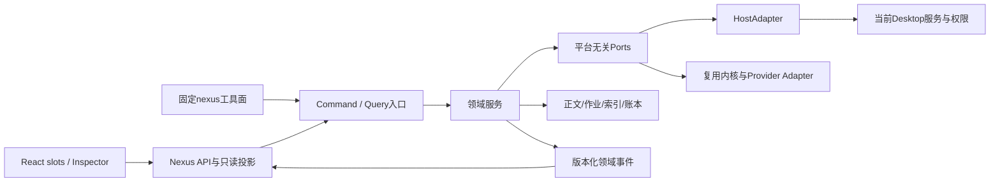
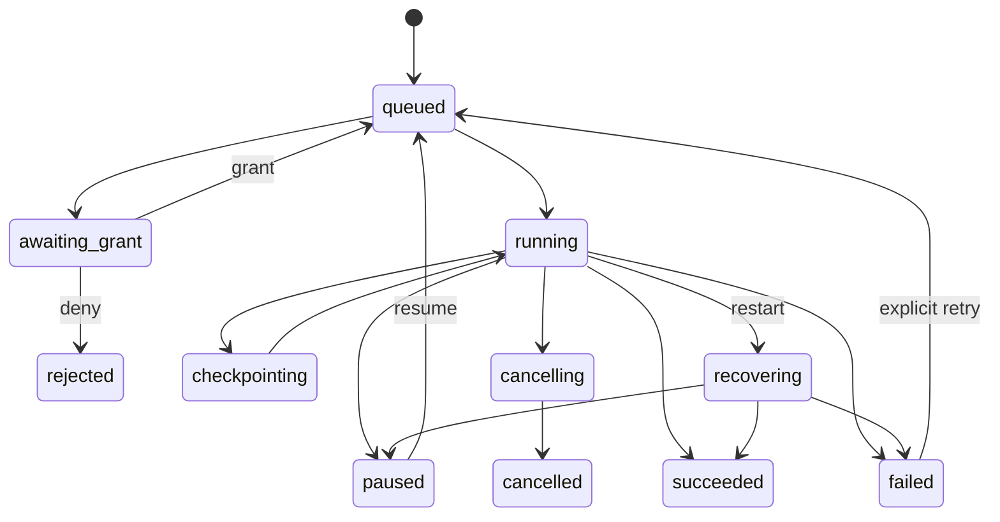

# 09 系统架构、数据与公共协议

本章定义 **Nexus 自己的设计合同**。其中 `HostAdapter`、`nexus_*`、对象名和错误码并非官方同名 API。接入实际 DeepSeek Harness 的代码必须由第 01 章对应固定版本证据支撑。研究版本是 2026-10-19 核验的 Desktop `0.2.1-rc.2`；“当前最新”不能作为将来放宽兼容范围的理由。

## 1. 单插件的实际含义

用户安装一个包，得到一个设置入口、一套来源锁、一套升级与回滚计划、一套授权语义和统一 UI。内部允许多 entry、worker、按需二进制、复用库和第三方服务。不能把旧插件原封不动全部启动后仅包一层菜单，因为那会同时保留重复提示词、重复工具、多个压缩器、冲突的 shell 包装和多份持久化。

建议包名占位 `@local/dsh-nexus`，实际 scope 在发布前决定。顶层包声明遵守第 01 章，不预先在规格里捏造 `dsh.compatibility` 等官方准入字段。精确依赖和源码锁随实现仓库提交；对用户只暴露 Nexus 的公共工具与服务。

```text
plugin/
  src/
    host/             当前DSH合同、网关、权限、生命周期和版本适配
    domain/           memory/workflow/quality/context/graph/recovery/runtime
    ports/            平台无关接口、DTO、错误、receipt
    adapters/         upstream kernels、Provider、VCS、CLI、codecs
    client/           slots、工作台、Inspector、设置、投影订阅
    workers/          索引、捕获、解析、隔离插件和耗时任务
  assets/             许可明确的技能、专家、主题及方法资源
  schemas/            API、配置、持久化格式和事件版本
  migrations/         可恢复的配置与数据迁移
  tests/              合同/领域/集成/Desktop/缓存回放
  vendor/             必要时放置有来源锁的复用源码与补丁
  notices/            每组件版权、许可、出处附加条款
```

这是实施期建议结构；本次工程仅已创建规格与研究资料，不应把目录建议误认成已实现代码。

### 1.1 依赖方向



领域模块不能直接读取 renderer 状态、用户凭据文件或其他插件的全局 registry。客户端不持有账户 secret、不调用任意本机端口、不拼接磁盘绝对路径进行写入。所有文件、进程、网络和会话操作经过授权后的 ports。

### 1.2 启动与停用

启动分为 `discover → validate → prepare → register → ready`。只有 `register` 成功提交的 generation 可对外承接请求。任一步失败，按相反顺序回收已创建资源并返回具名故障；不能留下半套工具或设置页。

停用分为 `quiescing → draining → disposed`。停止接收新写操作，取消可取消的后台任务，持久化可恢复作业，完成或补偿正在提交的数据写入，再释放 tool、slot、route、watcher、worker、timer、wrapper。超时的子进程终止遵循进程树与宿主权限。持久记忆、配置、审计、检查点不能因停用而删除。

每项可执行注册都有 `ownerId + generation + resourceId + disposer`。清理只作用于自己的 generation，绝不全量清空其他插件路由或覆盖后来者。确需包装 `fetch` 或 shell seam 的复用适配只允许一个集中链，保存原句柄、验证仍拥有该层后再卸载；不允许每个旧插件各包一遍。

## 2. HostAdapter 必备能力

| Port | 领域语义 | 失败与补偿 |
|---|---|---|
| `HostFacts` | 版本、profile、平台、公开能力、插件配置位置与连接状态 | 缺少特定能力仅暂停相关功能；不把未知当支持 |
| `HostLifecycle` | 注册/撤销、agent生命周期、shutdown、dispose | generation幂等、重入防护 |
| `HostTools` | 注册固定工具、权限元数据、调用结果与取消信号 | 重复名拒绝，不覆盖宿主工具 |
| `HostSessions` | create/fork/prompt/inject/快照/投影/生命周期 | 不改宿主日志；inject与唤醒语义分开 |
| `HostModels` | 明确provider/model调用、usage与流式事件 | 不从renderer传真实key；请求取消/计费可能仍发生 |
| `HostPrompt` | 静态段贡献、会话快照、当前轮追加材料 | 会话epoch固定，历史不回写 |
| `HostApproval` | 精确动作/资源范围的授权证据 | 无法取得必要授权时fail-closed |
| `HostFilesystem` | 在实际权限内解析、读写、监视与工作区身份 | realpath/junction校验与revision |
| `HostExecution` | shell/PTY/worker/外部CLI与终止 | 一致cwd、输出、exit、cancel语义 |
| `HostGateway` | 同认证Connection API、远程订阅和文件响应 | 不硬编码随机端口，不向浏览器导出认证值 |
| `HostPresets` | 正式bundle预设声明和依赖装配 | 原子更新，未成功不能显示“已启用” |
| `HostSecrets` | 通过reference在host侧解析secret | 日志、导出、投影仅含reference和脱敏状态 |

实际可用的官方名字由第 01 章映射。内部兼容桥必须有 `hostVersionRange + upstreamSha + contractFixture + risk + replacementPlan`，仅接触已锁定的结构。未知结构停止该次操作，不能盲写内部对象。

## 3. 共享对象与身份

### 3.1 公共标识

所有 ID 是不透明字符串，不能通过客户端输入构造磁盘路径。公开 ID 不包含账户 key、绝对用户主目录、完整命令或私有仓库 token。推荐随机 UUID/ULID，内容寻址对象使用带算法前缀的 digest，两者用途分开。

| 字段 | 合同 |
|---|---|
| `workspaceId` | 宿主身份优先；内部映射保留原始与规范路径、仓库远端指纹和worktree身份 |
| `projectId` | 用户认可的跨工作区逻辑项目；不能仅凭同名目录自动合并 |
| `sessionId` | 宿主会话ID；Nexus不能自行改写其语义 |
| `actorId` | 当前人/主agent/子agent/CLI/worker，带主体类型及父级 |
| `requestId` | 一次客户端意图的幂等键；网络重试沿用，修改意图需新ID |
| `operationId` | 被调度长作业；一个request可产生多个有父子关系的operation |
| `revision` | 对象单调版本，写入携带期望版本；不使用客户端时钟当版本 |
| `generation` | 运行时注册代际；与业务对象revision不同 |
| `traceId` | 内部关联，不含秘密；可跨工具、作业、投影、usage关联 |
| `contentHash` | 明确算法与规范化规则，校验内容和去重；不能证明远端KV命中 |

`requestId`的规范含义是`intentRequestId`，不能复用为收费模型调用的主键。一个意图可产生多个`logicalCallId`，每个调用有独立`attemptId`，供应商可另返回`providerRequestId`。Usage主键是`logicalCallId + attemptId`，同时保留意图、operation与父operation关联。一次整理任务并行两次模型调用，其中一次重试，应保留三笔真实attempt，外层幂等重试不得重新执行整理。

Windows 路径处理保留原大小写显示，不用简单 `toLowerCase()` 等同所有平台身份。UNC、长路径、盘符路径、junction、symlink、工作区重命名、git worktree 均需实际文件系统与宿主身份校验。远端相同只能产生“可能同项目”候选，用户确认后建立映射，不静默合并私密记忆。

### 3.2 核心对象

| 对象 | 最低字段 | 所有权 |
|---|---|---|
| `WorkspaceBinding` | id、hostWorkspaceId、pathRef、projectId、vcs、trust、revision | Nexus映射，文件仍属于用户 |
| `SessionBinding` | sessionId、parentBoundary、workspaceId、preset、epochs、controller | 宿主会话真源；本地仅附加索引 |
| `MemoryRecord` | id、scope、kind、title、bodyRef、evidence、lifecycle、validation、authority、revision | LOCAL正文Markdown；远端Provider保留其真源；详02章正交字段 |
| `Resource` | id、sourceUri、contentType、hash、provenance、accessPolicy | 导入原件与派生摘要明确分离 |
| `SkillAsset` | id、kind、version、entryRef、license、source、activationPolicy | 资产库 |
| `TaskPlan` | id、nodes、edges、scope、budget、definitionOfDone、revision | workflow域 |
| `Run` | id、planSnapshot、status、attempts、leases、receipts | 调度器 |
| `QualityReport` | id、configEpoch、baseline、findings、toolVersions、digest | quality域 |
| `ReviewReport` | id、vcsSnapshot、coverage、findings、evidenceReceipts | review域 |
| `CompressionBlock` | id、directCoverage、lineage、tier、summaryRef、originalRefs、state | 复用压缩核并加协议外壳 |
| `GraphDocument` | id、graphKind、ownerDomain、nodes、wires、views、versions、sourceBindings | 依据kind路由到领域真源；宿主会话仍独立 |
| `Artifact` | id、kind、mime、hash、pathRef、producer、references、trust | artifact域 |
| `RecoveryPlan` | id、workspace、boundary、paths、hashes、expiry、rescueRef、state | recovery域 |
| `UsageSample` | id、provider/model、tokens、pricingVersion、sourceLevel、requestRef | 观测账本，不充当供应商账单 |
| `ExtensionDescriptor` | id、source、version、hash、permissions、generation、state | 开发工作台 |
| `Receipt` | requestId、operationId、outcome、effects、before/after、timestamp | 持久可核验的动作结果 |
| `WorkflowBlueprint/HarnessSnapshot` | revision、tiers、frameworks、roles、gates、budgets、sourceRefs、contentHash | workflow域的版本化模板；active Run固定快照，非第二调度器 |
| `RoutePlan/RouteDecision` | role、ModelRef、capability/price快照、executor、reasonCodes、nodeAttempt | 同一Run内的角色路由；收费身份另为logicalCallId+attemptId |
| `RoutePartition/RouteLease` | providerRoute、model、非秘密账户域、协议、affinity、leaseRevision | 第07章缓存/路由合同；活跃root配置保持sticky |
| `GateVerdict` | actorId、contextLineageId、candidate/contractHash、checks、evidenceRefs、verdict | 主机验证的证据对象，不采纳写死PASS或作者自证 |

领域章额外字段兼容扩展，不能改变上述所有权。一个“删掉会话”动作不能同时永久删除图谱、记忆、索引和源文件；应先列明相关对象与引用，分别按所有权处理。

`MemoryReadView.trustProjection`是基于当前读取上下文、代码hash、时效和策略计算的只读投影，不能压成持久正文上的单一trust/status。投影记录evaluation inputs/version；不同上下文可产生不同trust而不增加记录revision。

公共`GraphRef.graphKind`枚举为`memory-relations / conversation-canvas / workflow-dag / artifact-diagram`，必须同时有`ownerDomain`。记忆关系经02章审核/CAS/Markdown管线写入；会话语义连线经05章图事务；任务DAG经04章；布局偏好可以共用。跨图只保存typed reference。记忆推演分支、画布分支与宿主fork是三个不同对象，不共享ID或授权语义。

### 3.3 Epoch

至少区分 `hostContractEpoch`、`toolSurfaceEpoch`、`promptEpoch`、`memorySnapshotEpoch`、`memoryStoreRevision`、`compressionEpoch`、`qualityConfigEpoch`、`pricingEpoch`。这些只用于描述真实变化，不能每轮凭空递增。`toolSchemaEpoch/toolsetEpoch`只在导入兼容层映射到`toolSurfaceEpoch`；`memoryEpoch`映射到已接受的`memorySnapshotEpoch`；`snapshotHash`映射到`memorySnapshotHash`。公共输出只发规范名，不能同时维护可独立变化的同义字段。

工具注册变化不自动修改运行中会话的模型工具表。记忆编辑不修改该会话已经发送的快照。价格更新不重算历史时覆盖原来的定价证据；可另算“按新表重估”。UI 主题变化不改变任何模型输入 epoch。

后台记忆写入只推进`memoryStoreRevision`，接受新固定快照才推进`memorySnapshotEpoch`。只解压到文件、不改模型投影时不推进`compressionEpoch`。公共时间统一ISO8601 UTC字符串；内部计时数值显式以`*Ms`命名，展示用宿主时区，日期型截止日是独立date-only类型。

### 3.4 固定依赖与来源继承

每个`ContextItem/SourceRef`带`binding=pinned|live`。pinned记录不可变version/hash，发送前只核验该版本仍存在、完整且有权访问，不要求等于latest；live明确比较当前revision。后台更新不能偷偷替换已固定快照。撤销权限、用户要求删除或完整性损坏仍使固定依赖不可发送，进入可解释重建或新会话计划。

Host fork复制的历史使用`originSessionId/originTurnId/originEventIdentity`或可验证lineage映射。继承前缀只重建读投影，不重新触发capture/摘要/retain/通知。capture去重使用原始来源身份+schemaVersion；无法核验来源时继承范围标为`historical_replay`，禁止外部写，子会话第一个新turn才产生新capture identity。

## 4. 公共模型工具

### 4.1 会话固定表

建议聚合工具如下；最终表由实现时实测工具提示成本确定。表、描述、JSON Schema、枚举排序和注册顺序在一个会话 epoch 内固定。上游原工具名作为迁移别名、目录索引或内部函数，不同时向模型铺开几十套重复工具。

| 工具 | action领域 | 默认属性 |
|---|---|---|
| `nexus_catalog` | search、describe、dependencies、capabilities | 只读，分页；详细schema按需 |
| `nexus_memory` | search、read、propose、commit、review、forget、sync | action决定权限；高风险独立审批 |
| `nexus_context` | status、compress、decompress、search、cache | 保留论文五类核心操作，统一压缩控制器 |
| `nexus_graph` | inspect、create、branch、wire、condense、weave、recall | write需revision；会话操作走host |
| `nexus_workflow` | plan、run、status、pause、cancel、resume、documents | 单一工作流调度器 |
| `nexus_quality` | discover、plan、lint、gate、fix、explain | 先识别已有配置；修复可审查 |
| `nexus_review` | capture、scope、run、findings、evidence | 只读VCS审查；独立快照 |
| `nexus_files` | search、read、edit、batch、document、refs | 根据action声明读写，输出有界 |
| `nexus_agents` | catalog、team、spawn、wait、message、stop、routes、harness、gates、adaptations | 多模型action扩展既有dispatcher，schema不因角色/模型变化；继承范围与预算，通信有来源 |
| `nexus_artifact` | list、read、create、preview、export | HTML不进入原生设置执行域 |
| `nexus_runtime` | diagnose、shell、preset、jobs | shell仍经过宿主sandbox与approval |
| `nexus_recovery` | checkpoints、plan、preview、apply、undo、gc | apply需新鲜plan与救援点 |
| `nexus_extensions` | stage、test、install、inject、reload、promote、release | 开发模式显式开启，资源有owner |
| `nexus_usage` | summary、samples、accounts、cache、prices | 只读、脱敏；poll不注入system |

固定工具表不代表所有操作默认获得权限。未配置的功能可以返回缺少依赖和下一步，不伪装成功。`nexus_catalog.describe` 返回的操作说明是数据，不能覆盖工具权限元数据。若宿主不能按 action 提供足够精确权限声明，则把写操作拆分成预先固定的只读/写入工具，生成新的完整会话工具 epoch；不能用一个“只读”dispatcher暗中执行写入。

### 4.2 请求与返回包络

```json
{
  "action": "read",
  "requestId": "req_01...",
  "target": {"id": "mem_01..."},
  "params": {"includeEvidence": true},
  "expectedRevision": 7,
  "cursor": null,
  "limit": 20
}
```

`requestId` 对写操作必须，对查询可选。只读分页默认 20、最大 200；原文工具输出默认上限 16 KiB/约定 token 预算，具体领域可更小。超限返回 `truncated + nextCursor + artifactRef`，不靠无提示截断。已存在的真实二进制产物走资源下载，不塞到 JSON/模型消息中。

```json
{
  "ok": true,
  "requestId": "req_01...",
  "operationId": null,
  "data": {"id": "mem_01...", "revision": 7, "bodyRef": "resource_01..."},
  "receipt": null,
  "warnings": [],
  "page": {"nextCursor": null, "truncated": false},
  "evidenceLevel": "persisted",
  "traceId": "trace_01..."
}
```

`ok` 只表示请求层成功，不能替代领域 `committed`、`completed`、`verified` 等结果。提交记忆必须有 `committed=true` 与receipt；提交恢复必须有逐路径校验状态；运行模型任务必须区分 accepted/running/completed。

工具输出可含简洁的人可读摘要，但不自动重复整个报告。输出格式字段顺序与无变化摘要稳定；不在每次 read 结果里强行附时钟、余额、banner、随机建议。追踪时间保存在观测层，确实与用户判断相关时才进入模型可见数据。

### 4.3 领域包络的唯一映射

外层公共JSON只使用本章包络；各章schema示例是领域payload或迁移形状，不是另一套默认wire。转换必须无损，并由同一catalog生成Native/PTC/UI合同：

| 领域旧字段/名称 | 规范位置 |
|---|---|
| `idempotencyKey` | 外层`requestId`，兼容`intentRequestId`；不得作为真实模型call ID |
| `arguments`、领域顶层query/scope等 | `params`；定位ID进入`target`，原语义保留 |
| `capabilityId/schemaDigest` | catalog解析与内部校验元数据，不授权任意动作 |
| `status/effectState/committed` | `data.domainOutcome`及`receipt.effects`，不得仅折成`ok` |
| `receipts[]` | `data.receipts`，顶层receipt引用本次总体提交；所有子receipt保留 |
| 领域error | 映射本章code，保留`details.domainCode/domainReason`，不靠英文判断 |
| `wf_* / suite_* / context_* / graph_*` | 内部capability或可选迁移别名，默认只注册本章固定`nexus_*`表 |
| `/api/suite/v1`等领域HTTP建议 | 逻辑方法；正式传输经`nexus`认证桥，可选旧路由只在明确兼容开关启用 |

严格拒绝未知字段发生在先归一化后的各层schema，不能将兼容示例直接送到不匹配的严格校验器。写操作即使旧示例中requestId可选，公共服务也必须补足或拒绝；不能因此跳过幂等。

## 5. UI 与远程接口

Native 页面通过官方 slot 和声明式服务接入；React 组件使用宿主 `--dsw-alias-*` 映射与本插件 tokens。不运行时 require 宿主客户端内部包，不把整个设置页做 iframe。

远程 API 以第 01 章核实的已认证连接为传输。下面的路径只是领域方法的建议命名，**不是承诺官方支持任意 HTTP route**：

| 方法 | 语义 |
|---|---|
| `nexus.snapshot` | 当前用户可访问范围的版本化视图 |
| `nexus.command` | 与工具共用command处理器，requestId与revision一致 |
| `nexus.query` | 分页查询，只读DTO |
| `nexus.subscribe` | 按主题与游标订阅投影增量 |
| `nexus.artifact.open` | 授权后取得受限资源响应/宿主原生文件句柄 |
| `nexus.cancel` | 取消operation；返回已完成、取消请求接受或不可取消 |

上述为业务方法名，不是需要分别注册的官方RPC端点。v1默认Host正式Connection Fetch注册exact POST `/api/nexus/rpc`，校验官方ClientRequest/ServerResponse信封；Client用 `connection.rpc.call('/api','nexus/rpc',nexusRpcRequest,signal)` 承载这些业务方法。共享`/api`的唯一interceptor已由Gateway占用，Nexus不可抢占。owner-only由Host exact dispatcher实施，Nexus另行核验业务权限；二进制另设exact授权路由。第01章与研究10给出源码合同，真实Desktop probe尚待实施。Typert生成挂载是可选增强，不能把生成器在官方monorepo可用当外部平铺工程已验证。

传输层唯一项目DTO如下。`payload`严格嵌入§4.2公共包络，不另造 `parameters`、字符串revision或顶层op/action副本：

```ts
interface NexusRpcRequest {
  protocolVersion: 1;
  method: string; // registry白名单，如host.probe、nexus.command、nexus.query
  scope: {sessionId?: string; workspaceId?: string};
  payload: NexusRequest; // action/requestId/target/params/expectedRevision:number/cursor/limit
}
```

Connection生成的外层 `ClientRequest.method` 固定为 `nexus/rpc`，`ClientRequest.payload` 是上式；其中的`method`选择具名业务入口，内层`payload.action`选择该入口允许的领域action，两者必须通过registry映射校验，不能任意反射。`scope`是待核验资源上下文，不是权限证明。业务`requestId`只存在于内层公共包络；实际每次载体的`rpcId`仍由Connection生成，长作业`operationId`由Host接纳后返回。

Host成功承接请求时，官方 `ConnectionRpcResult.value` 内是同一 `NexusResponse`，业务DTO在其`data`；业务失败保留Nexus错误及effect状态，不能只以载体`ok=true`显示业务成功。载体故障、信封非法与abort分别由Connection错误结果或reject处理，不把业务错误搬成泛化网络故障。查询可按§4.2省略requestId，写操作必须提供；同requestId不同规范请求hash必须拒绝。

连接断开后的重连先发送上次序号与快照版本；服务端支持从保留窗口重放，游标过期则明确 `RESYNC_REQUIRED` 并重新获取快照。客户端不能把本地乐观更新当最终成功。

HTML/图表产物预览与产品页面分离：预览必须有 trust 状态、外部网络策略、导航控制和安全下载。用户需要运行主动内容时有明确的“运行该产物”动作。读代码或Markdown时不得执行其脚本。

## 6. 持久化

### 6.1 真源划分

- 宿主会话、审批与官方配置由宿主拥有。Nexus 保存引用、投影和派生状态，不复制成可冲突的第二权威。
- LOCAL 记忆正文是 Markdown，加版本化元数据、证据引用和人可编辑边界。索引损坏可重建，不应丢正文。
- 外部Provider中的记忆保留 `providerId + externalId + remoteRevision`；缓存与导出不冒充远端已提交状态。
- Nexus 本身任务、作业、配置、receipts、图文档可以用嵌入式SQLite等事务存储。选择数据库是项目设计，实际Node/Electron ABI与可分发性必须先验证。
- 大正文、报告、文件blob、压缩原文使用内容寻址资源，数据库保存引用、大小、hash和生命周期。绝不把密钥混入导出。

存储位置由宿主plugin storage port解析，不在renderer假设 `~/.dsh`。项目级共享记忆可以位于项目中明确目录；选择目录前展示内容、git忽略/共享影响和现有文件冲突。

### 6.2 事务与故障恢复

文件写入采用同文件系统临时文件、完整校验、原子替换；跨文件事务采用journal与可恢复状态，不声称多文件rename天然原子。数据库事务与文件写入通过 outbox/receipt 关联。

写入流程为 `validate → lock → verifyRevision → prepare → durableIntent → apply → verify → durableReceipt → emitProjection`。事件必须在durable commit后发布；客户端看到已完成意味着重启后仍可查询同一个receipt。崩溃出现在任何边界均有恢复动作。

### 6.3 锁与并发

锁按资源细化：会话控制器、工作区恢复、记忆scope、外部Provider目标、扩展generation。长模型调用不持有文件写锁。需要多资源时按稳定ID排序取锁，避免互相等待。锁具备owner、heartbeat/lease、过期恢复与持久化证据，不能仅依赖内存布尔值。

同一requestId+请求digest重复调用返回同receipt。相同requestId不同digest返回 `IDEMPOTENCY_CONFLICT`。revision冲突返回当前revision与可安全显示的差异，不能覆盖。不可重放操作如发布、付款式供应商API、发送渠道消息必须先查receipt，不因网络超时自动再做一次。

## 7. 作业状态、预算与取消



每个外部动作声明是否可重试、是否可能已经生效、如何核验。取消接受不等于外部服务一定未计费或未提交。`cancelled` 结果保留已发生效果和可撤销项；不能把成功产物丢掉。

统一预算包含并发、墙钟、模型输入/输出、cache miss上限、货币、外部API次数、文件/磁盘/内存。软预算给可解释提醒，硬预算在下次可控动作前阻断，不杀死正在提交的文件事务。父计划分配子预算并汇总消耗，不让子任务各自得到完整父预算。

## 8. 错误合同

| code | 含义 | UI/调用方行为 |
|---|---|---|
| `INVALID_ARGUMENT` | schema/枚举/大小不合法 | 标出字段，不能请求重试相同无效输入 |
| `NOT_FOUND` | 对象不存在或不可访问 | 同级显示，不泄露其他用户对象 |
| `REVISION_CONFLICT` | 并发修改 | 重新加载/比较/合并 |
| `IDEMPOTENCY_CONFLICT` | requestId复用于不同意图 | 生成新请求，不重写旧receipt |
| `PERMISSION_REQUIRED` | 当前范围未获授权 | 提供具体可审查动作与宿主渠道 |
| `PERMISSION_DENIED` | 明确拒绝 | 停止依赖动作，保留计划 |
| `DEPENDENCY_MISSING` | 服务/CLI/模型未配置或不存在 | 具名配置引导，可独立功能继续 |
| `HOST_CONTRACT_UNSUPPORTED` | 当前host缺合同/内部桥不匹配 | 停止相关动作，输出版本/adapter事实 |
| `STALE_PLAN` | 预览条件、hash、授权或有效期已失效 | 重新计划与预览 |
| `BUDGET_EXCEEDED` | 硬预算不足 | 暂停并提供成本与可缩减方案 |
| `RATE_LIMITED` | 供应商/host限流 | 返回retryAfter与已消费信息 |
| `UPSTREAM_UNAVAILABLE` | 网络/服务不可用 | 有界退避、可取消，避免轮询风暴 |
| `PARTIAL_EFFECT` | 已发生部分效果 | 列receipt、剩余项与补偿 |
| `INTEGRITY_FAILED` | hash、格式、schema不符 | 保留原件并隔离，不能默默跳过 |
| `RESYNC_REQUIRED` | 增量游标不可重放 | 重取快照，不能继续应用缺口事件 |
| `CANCELLED` | 取消完成 | 展示已发生效果与恢复点 |
| `INTERNAL` | 未分类故障 | 给traceId，秘密不进入错误文本 |

标准错误字段为 `code/message/retryable/details/operationId/traceId/effects`。本地堆栈留在脱敏诊断里，不发给模型或网页。网络错误不能直接把 Authorization header、完整URL query或环境变量输出。

## 9. 安全、授权与隐私

此处约束的是未来插件行为，不是为本次写规格增加审批步骤。读取、可逆分析、用户已授权范围内动作按宿主规则执行；跨范围、向外发送、发布或恢复文件按实际授权合同处理，用户已有授权必须复用。

导入的README、网页、历史对话、lint输出、技能素材、模型建议均视为带来源数据，不能自行提升成用户新指令。系统要允许用户显式启用技能的指导作用，并保留它来自何处。自动旁观评审不可以 `user` 身份伪造真实人类指令。

secret采用reference；不同供应商与账户的HTTP访问有独立allowlist与重定向规则。余额监控使用只读/低权限凭据；管理key与推理key不得互换。外部抓取限制协议、响应大小、超时、重定向、私网与DNS重绑定，具体供应商例外要具名。

诊断默认不包含正文、全命令、敏感路径和会话输入；需要诊断包时先展示文件清单和脱敏结果。可选遥测默认关闭，启用也不上传用户代码与真实token。

## 10. 自定义与扩展

对外稳定扩展点为 `MemoryProviderPort`、`QualityRunnerPort`、`WorkflowStepPort`、`ArtifactRendererPort`、`SearchProviderPort`、`AccountAdapterPort`、`RuntimeDescriptorPort`。每个扩展声明版本、权限、能力、配置schema、生命周期和许可；不能默认获得host/context全对象。

开发工作台保留原super-injector的同进程联调、临时安装、staging工具不进模型schema、热换、失败保旧和转正价值。模式按信任与所需语义选择：可信当前接口走`native-managed`，可信旧接口且需要共享服务/内存走版本锁定的同进程`compat-managed`；不可信或可RPC化的扩展走`isolated-worker`。不能因接口旧就强制worker化而丢失同进程功能。代码模块隔离不等于进程/OS安全隔离。翻译桥对工具/事件/UI/HTTP的映射不能消除原功能，无法翻译的接缝必须明确实施而不是永久隐藏按钮。

## 11. 系统验收

| ID | Given / When | 必须结果 |
|---|---|---|
| SYS-001 | 只安装一个Nexus包且未安装原插件 | 已声明内置的全部模块能注册，无缺失外部原插件错误 |
| SYS-002 | 某可选Provider未配置 | 本地记忆与会话仍可用，依赖状态准确 |
| SYS-003 | 同写请求重复20次且中途断线 | 仅一次效果、相同receipt |
| SYS-004 | 相同requestId不同body | 明确幂等冲突，不覆盖 |
| SYS-005 | 两窗口同时改同revision | 一次成功，一次冲突并可比较 |
| SYS-006 | 任意持久化边界杀进程 | 重启能核验成功或恢复/补偿，无半完成伪成功 |
| SYS-007 | 卸载与热载循环20次 | 无重复工具/route/timer/worker/wrapper残留 |
| SYS-008 | 重连游标缺口 | resync后状态一致，无重复任务/消息 |
| SYS-009 | 主题/余额/时钟变化 | 模型system/tool hash不变 |
| SYS-010 | 工具内部调用缺权写操作 | 宿主拒绝，dispatcher不绕过声明 |
| SYS-011 | 子作业用完父预算 | 父汇总一致，不获额外预算 |
| SYS-012 | API错误带上游secret | UI、模型、日志与导出均已脱敏 |
| SYS-013 | 用户改LOCAL Markdown后重建索引 | 以正文为真源并保留revision/冲突，不用旧索引覆盖 |
| SYS-014 | 远端Provider已提交但本地断线 | 重试可核验remote revision，不重复写入 |
| SYS-015 | 某扩展热载失败 | 旧generation仍可用，新代资源全部回收 |
| SYS-016 | host升级至未知版本 | 明确受影响能力；不碰未知内部结构，核心只读诊断可用 |
| SYS-017 | 导入恶意网页/README | 当作数据，不能发送消息/扩权/改变system |
| SYS-018 | 两个工作区只同目录名 | 不自动合并记忆/检查点/账本 |
| SYS-019 | 取消时外部API已产生费用 | receipt保留已消费与不可撤销效果 |
| SYS-020 | 运行缓存回放与领域测试 | 对象epoch、事件和usage关联完整可追踪 |
